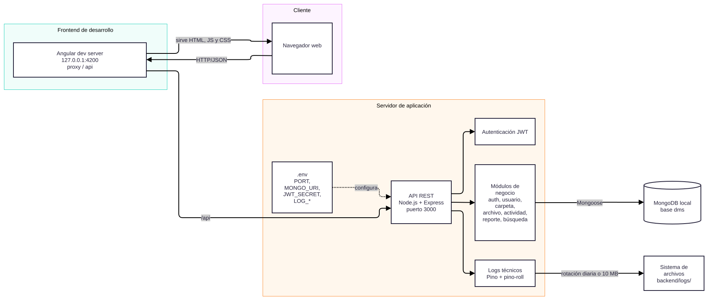
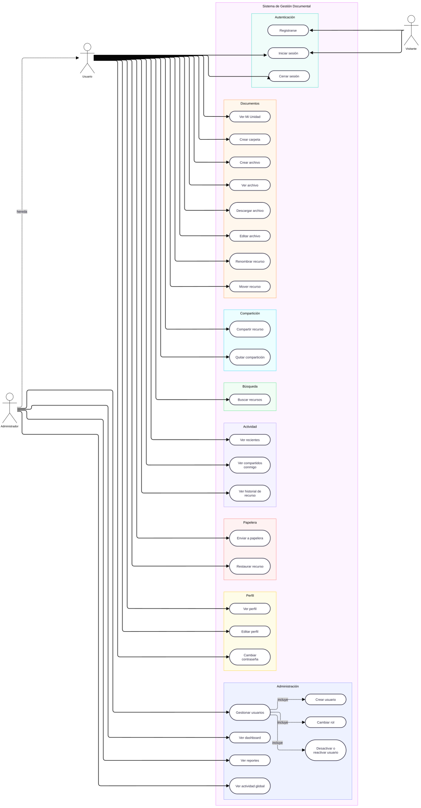
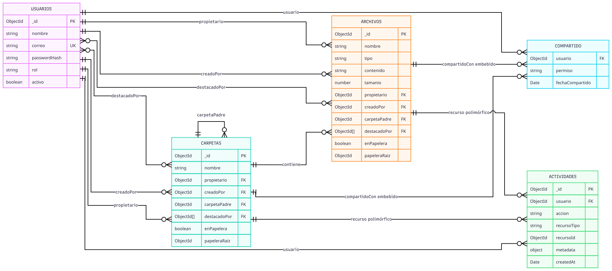
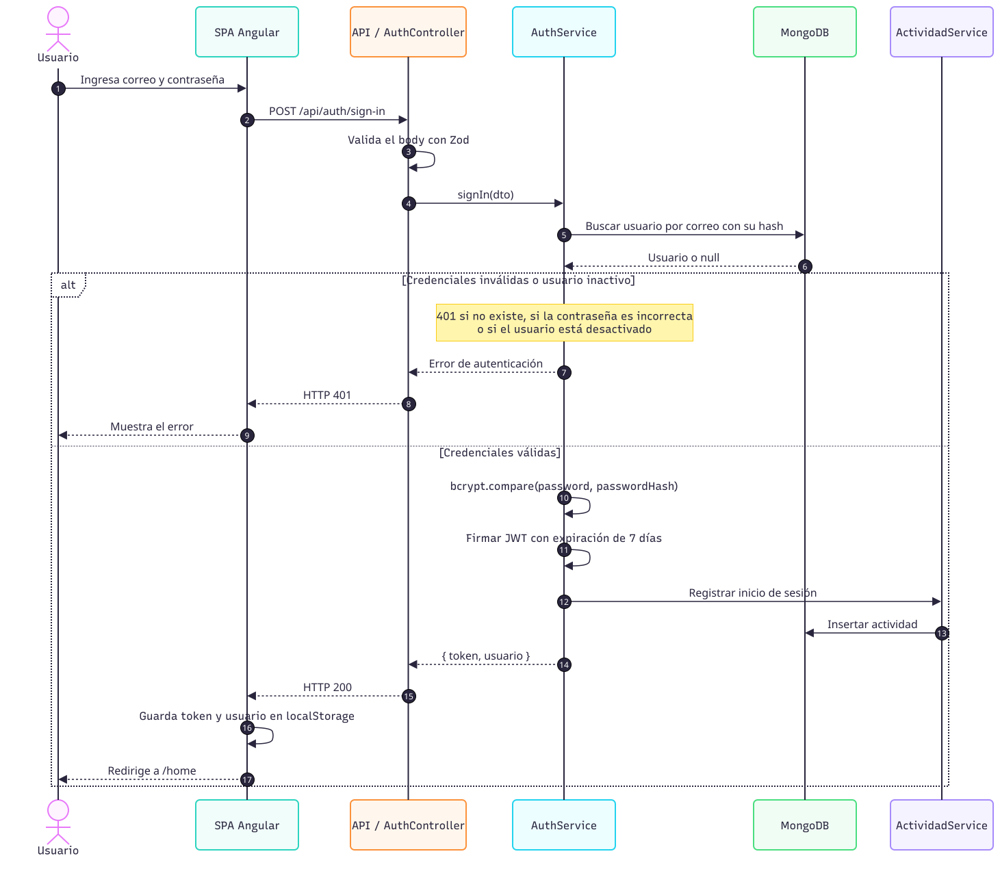
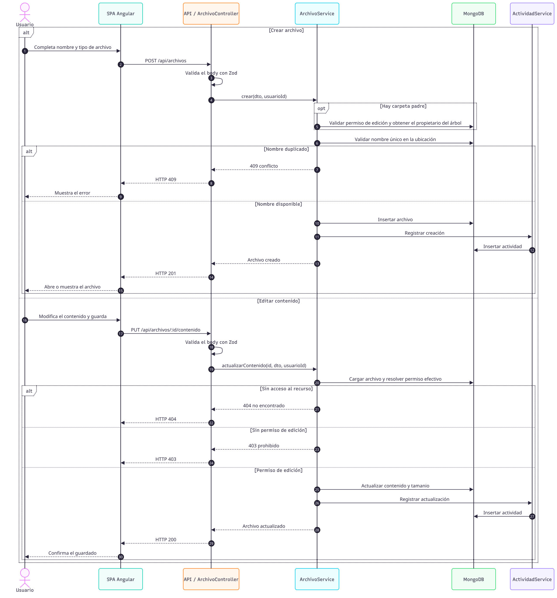
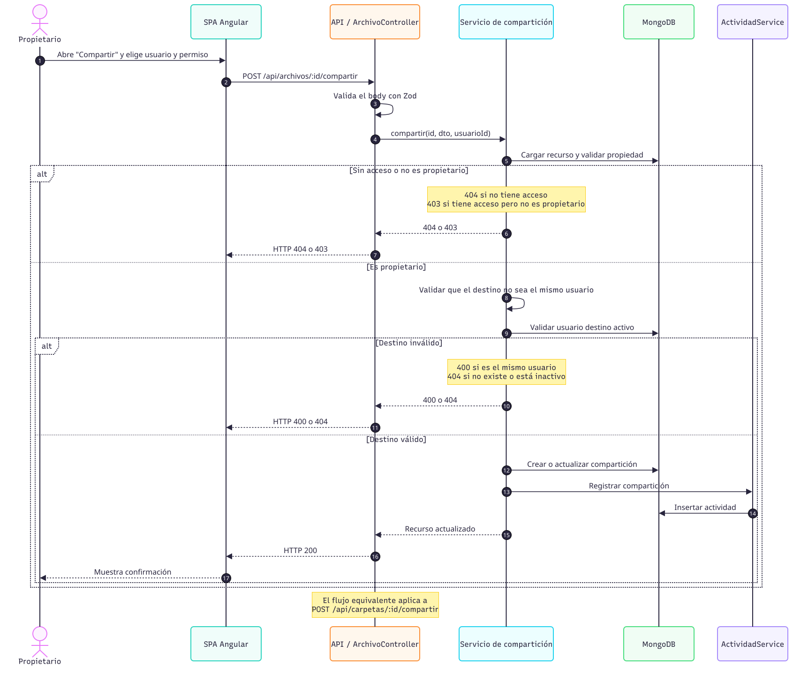
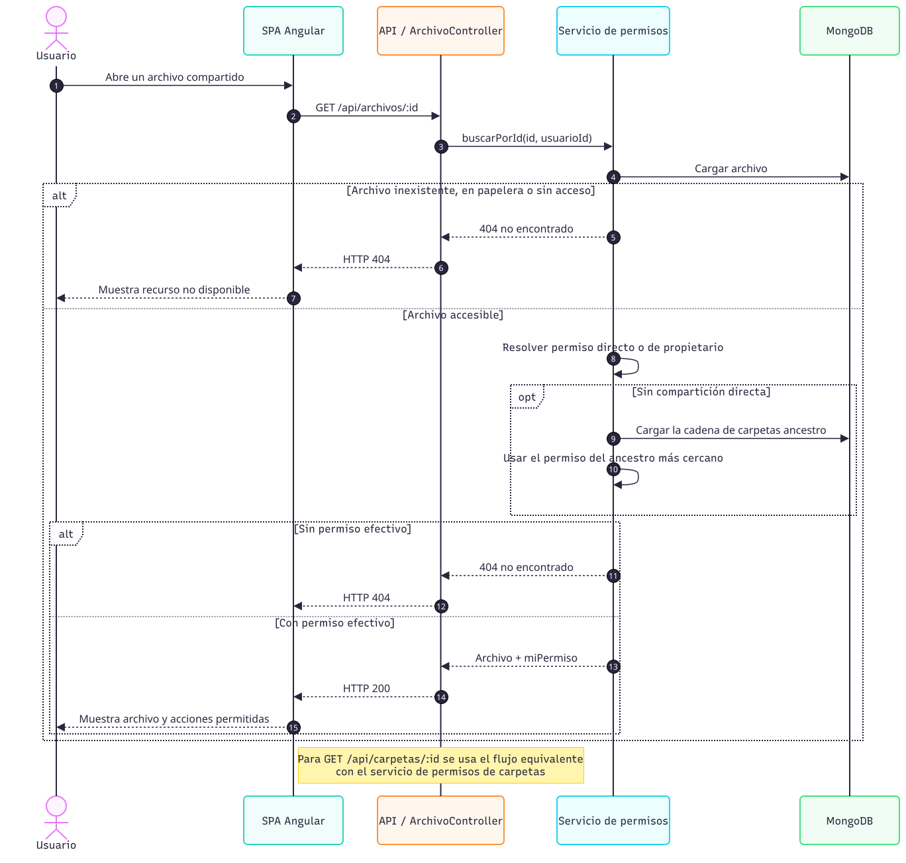
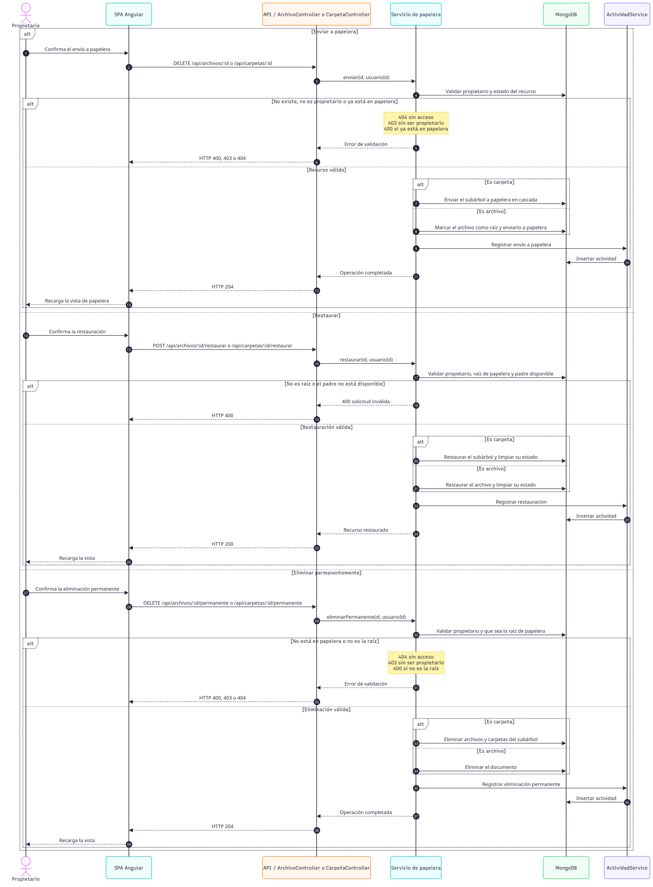
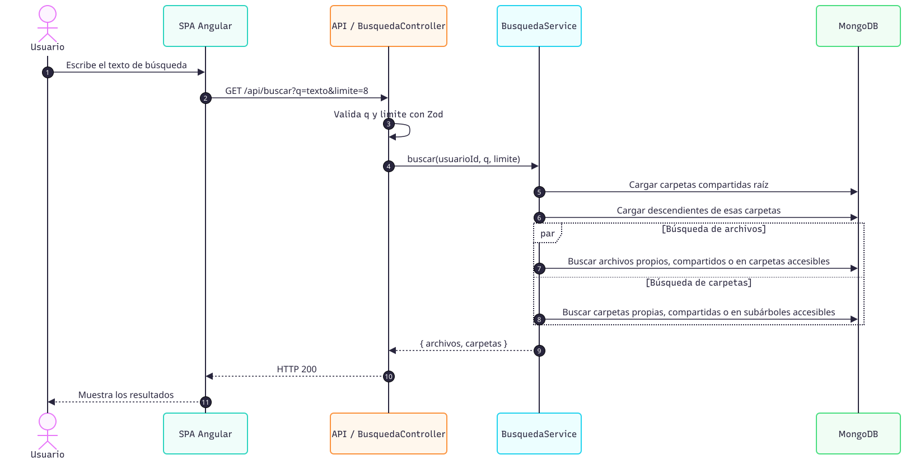

<div class="portada">
  
  <div class="portada-contenido">
    <p class="portada-universidad">
      Universidad de San Carlos de Guatemala<br>
      Centro Universitario de Occidente<br>
      División de Ciencias de la Ingeniería<br>
      Ingeniería en Ciencias y Sistemas<br>
      Manejo e Implementación de Archivos
    </p>
    
    <div class="portada-titulo">
      <span class="portada-sistema">Sistema de Gestión Documental</span>
      <strong class="portada-manual">Manual técnico</strong>
      <span class="portada-subtitulo">Arquitectura, modelo documental, API REST y operación</span>
    </div>
    <p class="portada-autor">Juan Giovani Casiá Pérez<br><span>201930457</span></p>
    <p class="portada-fecha">sábado, 24 de octubre de 2026</p>
  </div>
</div>

# Índice

1. [Introducción](#1-introducción)
2. [Arquitectura general](#2-arquitectura-general)
   - [2.1 Vista de alto nivel](#21-vista-de-alto-nivel)
   - [2.2 Capas del backend](#22-capas-del-backend)
   - [2.3 Capas del frontend](#23-capas-del-frontend)
   - [2.4 Casos de uso](#24-casos-de-uso)
3. [Tecnologías y requisitos](#3-tecnologías-y-requisitos)
   - [3.1 Stack tecnológico](#31-stack-tecnológico)
   - [3.2 Módulos de Node usados en el backend](#32-módulos-de-node-usados-en-el-backend)
   - [3.3 Módulos internos del backend](#33-módulos-internos-del-backend)
4. [Estructura del repositorio](#4-estructura-del-repositorio)
5. [Modelo documental](#5-modelo-documental)
   - [5.1 Colección usuarios](#51-colección-usuarios)
   - [5.2 Colección carpetas](#52-colección-carpetas)
   - [5.3 Colección archivos](#53-colección-archivos)
   - [5.4 Colección actividades](#54-colección-actividades)
   - [5.5 Relaciones e invariantes](#55-relaciones-e-invariantes)
   - [5.6 Índices relevantes](#56-índices-relevantes)
   - [5.7 Diagrama del modelo](#57-diagrama-del-modelo)
6. [Seguridad y control de acceso](#6-seguridad-y-control-de-acceso)
    - [6.1 Autenticación](#61-autenticación)
    - [6.2 Contraseñas](#62-contraseñas)
    - [6.3 Roles](#63-roles)
    - [6.4 Permisos sobre recursos](#64-permisos-sobre-recursos)
    - [6.5 Otras medidas](#65-otras-medidas)
7. [Reglas de negocio](#7-reglas-de-negocio)
   - [7.1 Carpetas y archivos](#71-carpetas-y-archivos)
   - [7.2 Papelera](#72-papelera)
   - [7.3 Usuarios](#73-usuarios)
   - [7.4 Búsqueda](#74-búsqueda)
   - [7.5 Destacados](#75-destacados)
   - [7.6 Diagramas de secuencia](#76-diagramas-de-secuencia)
8. [API REST](#8-api-rest)
    - [8.1 Convenciones](#81-convenciones)
    - [8.2 Endpoints](#82-endpoints)
9. [Actividad y auditoría](#9-actividad-y-auditoría)
    - [9.1 Actividad de negocio](#91-actividad-de-negocio)
    - [9.2 Logs técnicos](#92-logs-técnicos)
10. [Decisiones de diseño y rendimiento](#10-decisiones-de-diseño-y-rendimiento)
    - [10.1 Decisiones estructurales](#101-decisiones-estructurales)
    - [10.2 Resolución de permisos en lote](#102-resolución-de-permisos-en-lote)
    - [10.3 Operaciones masivas en papelera](#103-operaciones-masivas-en-papelera)
    - [10.4 Índices y agregaciones](#104-índices-y-agregaciones)
    - [10.5 Limitaciones conocidas](#105-limitaciones-conocidas)
11. [Instalación y operación](#11-instalación-y-operación)
    - [11.1 Backend](#111-backend)
    - [11.2 Frontend](#112-frontend)
    - [11.3 Verificación mínima](#113-verificación-mínima)
    - [11.4 Datos de demostración](#114-datos-de-demostración)
    - [11.5 Generación de los manuales PDF](#115-generación-de-los-manuales-pdf)
12. [Guía de mantenimiento](#12-guía-de-mantenimiento)
    - [12.1 Añadir o modificar un endpoint](#121-añadir-o-modificar-un-endpoint)
    - [12.2 Añadir una vista Angular](#122-añadir-una-vista-angular)
    - [12.3 Gotchas del proyecto](#123-gotchas-del-proyecto)
13. [Verificación realizada](#13-verificación-realizada)
14. [Glosario](#14-glosario)

# 1. Introducción

Este manual describe la implementación técnica del **Sistema de Gestión Documental
(DMS)**, una aplicación web para almacenar, organizar, compartir y auditar archivos
`.txt` y `.md` entre los usuarios de una organización.

El documento está dirigido a quienes necesitan instalar, mantener, evaluar o extender
el sistema: desarrolladores, administradores de base de datos, docentes y revisores
técnicos. Se explican la arquitectura, el modelo documental, las reglas de negocio,
la API, los mecanismos de seguridad, los módulos de Node usados, las decisiones de
diseño con sus ventajas y costos, y los procedimientos de operación. Los diagramas
exportados se incluyen como figuras.

El repositorio se divide en dos aplicaciones independientes:

- `backend/`: API REST con Node.js, Express 5, TypeScript, Zod y Mongoose.
- `frontend/`: aplicación SPA con Angular 21 standalone, signals y Angular Material.

Ambas se comunican por HTTP/JSON. En desarrollo, el servidor de Angular redirige
`/api` al backend mediante `proxy.conf.json`.

# 2. Arquitectura general

## 2.1 Vista de alto nivel

```text
┌──────────────────────────┐        HTTP/JSON        ┌──────────────────────────┐
│ Cliente Angular 21       │  ───────────────────►   │ API Express + TypeScript │
│ SPA, signals, Material   │  ◄───────────────────   │ JWT, Zod, reglas         │
└──────────────────────────┘        Bearer token     └────────────┬─────────────┘
                                                                  │ Mongoose
                                                                  ▼
                                                       ┌──────────────────────────┐
                                                       │ MongoDB                  │
                                                       │ usuarios, carpetas,      │
                                                       │ archivos, actividades    │
                                                       └──────────────────────────┘
```

El cliente no accede directamente a MongoDB. Toda operación pasa por la API, que
valida el token, comprueba permisos y registra la actividad correspondiente.

<figure class="diagrama">
  
  <figcaption>Figura 1. Despliegue local: SPA Angular, API Express, MongoDB y logs Pino.</figcaption>
</figure>

## 2.2 Capas del backend

Cada módulo respeta el siguiente flujo:

```text
Routes → Middlewares → Controller → Service → Repository → Model
                         │            │
                         │            ├── Validators (reglas de negocio)
                         │            ├── Permisos (autorización)
                         │            └── Servicios auxiliares (compartidos, papelera)
                         └── Traducción HTTP de resultados y errores
```

- **Routes:** declara endpoints y aplica autenticación, autorización y validación Zod.
- **Controller:** extrae datos de `req`, invoca el servicio y responde con el código HTTP.
- **Service:** orquesta el caso de uso, aplica reglas y registra actividad.
- **Repository:** encapsula consultas y agregaciones de MongoDB.
- **Model:** define esquemas, índices, valores por defecto y transformaciones JSON.
- **Validators:** concentran reglas reutilizables de unicidad y jerarquía.
- **Servicios de permisos:** resuelven acceso directo y heredado.
- **Servicios de compartidos y papelera:** separan operaciones con efectos masivos.

La inyección de dependencias es manual y centralizada en
`backend/src/shared/container/container.ts`.

## 2.3 Capas del frontend

```text
app.routes.ts
  └── Layout protegido (sidebar + topbar)
        ├── Inicio → carpetas y archivos recientes
        ├── Mi Unidad → Explorador reutilizable → Menú contextual
        ├── Destacados
        ├── Recientes
        ├── Compartidos
        ├── Papelera
        ├── Visor / Editor
        ├── Perfil
        └── Administración (dashboard, usuarios, reportes, actividad)
```

- Componentes **standalone**, sin `NgModule`.
- Estado local con **signals** y detección de cambios **zoneless**.
- Rutas **lazy** con `loadComponent`.
- `authGuard`, `guestGuard` y `adminGuard` protegen la navegación.
- `authInterceptor` añade `Authorization: Bearer <token>` y cierra sesión ante `401`.
- Servicios de `core/services` encapsulan la API; los modelos viven en `core/models`.
- `ExploradorCarpetaComponent` se usa en Mi Unidad; `MenuContextualComponent` y
  `AccionesRecursosService` se reutilizan en Mi Unidad, Papelera, Destacados y
  Compartidos.
- La vista lista/cuadrícula se persiste en `localStorage`; la búsqueda global es un
  autocompletado de la barra superior.

## 2.4 Casos de uso

El diagrama agrupa los casos por autenticación, documentos, compartición, búsqueda,
actividad, papelera, perfil y administración. El administrador hereda los casos del
usuario y conserva el menú normal.

<figure class="diagrama">
  
  <figcaption>Figura 2. Casos de uso actuales, incluidos destacados y borrado permanente.</figcaption>
</figure>

# 3. Tecnologías y requisitos

## 3.1 Stack tecnológico

| Capa | Tecnología | Uso |
|---|---|---|
| Frontend | Angular 21.2 | SPA, rutas, formularios y signals |
| UI | Angular Material 21 | Tablas, diálogos, menús y formularios |
| Reactividad | RxJS 7.8 | Observables en servicios HTTP |
| Markdown | `marked` 18 | Renderizado del visor y la vista previa |
| Backend | Node.js 20+ | Entorno de ejecución |
| Servidor | Express 5.2 | API REST y middlewares |
| Lenguaje | TypeScript 7 (backend) y 5.9 (frontend) | Tipado estricto |
| Validación | Zod 4 con `zod/v3` | DTO, query, params y entorno |
| Base de datos | MongoDB 7+ | Persistencia documental |
| ODM | Mongoose 9 | Esquemas, índices y agregaciones |
| Autenticación | JWT 9 + bcrypt 6 | Sesión y hash de contraseñas |
| Logs | Pino 10, `pino-http` 11 y `pino-roll` 4 | Diagnóstico y rotación |
| Pruebas frontend | Vitest 4 + jsdom | Pruebas unitarias de utilidades |

Requisitos prácticos:

- Node.js 20.19+ o 22.12+; el entorno validado usa Node 22.
- npm 10+; el frontend declara npm 11.6+.
- MongoDB local o remoto.
- Puerto `3000` para la API y `4200` para el frontend en desarrollo.
- Google Chrome para regenerar los PDF de `docs/pdf/` con `generar.mjs`.

## 3.2 Módulos de Node usados en el backend

Dependencias de ejecución declaradas en `backend/package.json`:

| Paquete | Versión | Función real |
|---|---:|---|
| `express` | 5.2.1 | Framework HTTP, routers, middlewares y controladores. Express 5 reenvía rechazos de promesas al error handler. |
| `mongoose` | 9.11.1 | ODM: conexión, esquemas, índices, `$graphLookup`, `$lookup`, `$unionWith` y agregaciones. |
| `zod` | 4.6.5 | Validación de entorno, body, query y params. El código usa la ruta de compatibilidad `zod/v3`. |
| `jsonwebtoken` | 9.0.3 | Firma y verificación del JWT. |
| `bcrypt` | 6.0.0 | Hash y comparación de contraseñas con `BCRYPT_ROUNDS`. |
| `cors` | 2.8.6 | Allowlist de orígenes, credenciales y cabeceras expuestas. |
| `dotenv` | 18.0.6 | Carga de `.env` antes de validar la configuración. |
| `pino` | 10.4.0 | Logger estructurado, niveles, `redact` y serializadores. |
| `pino-http` | 11.0.0 | Registro de una entrada por petición HTTP. |
| `pino-roll` | 4.0.0 | Transport de archivo con rotación diaria o por tamaño y retención. |

Dependencias de desarrollo:

| Paquete | Versión | Función |
|---|---:|---|
| `typescript` | 7.0.2 | Compilación con `npm run build` y verificación con `tsc --noEmit`. |
| `tsx` | 4.23.15 | Ejecución directa de `seed.ts` y `server.ts` en desarrollo. |
| `pino-pretty` | 13.2.0 | Salida legible en `NODE_ENV=dev`. |
| `@types/node`, `@types/express`, `@types/cors`, `@types/jsonwebtoken`, `@types/bcrypt` | — | Tipos para TypeScript. |

No se usan `helmet`, `multer`, `express-session`, `passport` ni un framework de
inyección de dependencias. La carga de archivos viaja como string JSON, no como
`multipart/form-data`.

Módulos built-in de Node:

| Módulo | Uso |
|---|---|
| `node:fs` | Crea el directorio de logs con `mkdirSync`. |
| `node:path` | Resuelve `LOG_DIR` y construye rutas de archivos. |
| `node:crypto` | Genera el `requestId` con `randomUUID`. |
| `Buffer` (global) | Calcula `tamanio` con `Buffer.byteLength(contenido, 'utf8')`. |
| `process` (global) | Variables de entorno, apagado y `process.exit` ante configuración inválida. |

## 3.3 Módulos internos del backend

| Módulo | Responsabilidad |
|---|---|
| `auth` | Login, registro, emisión de JWT y `/me`. |
| `usuario` | Cuentas, roles, estado, perfil, contraseña y directorio para compartir. |
| `carpeta` | Árbol, permisos, compartición, destacados y papelera de carpetas. |
| `archivo` | Contenido, metadatos, permisos, compartición, destacados, descarga y papelera. |
| `actividad` | Auditoría funcional, historial propio, global y por recurso. |
| `reporte` | Agregaciones de dashboard, archivos, usuarios, compartición y actividad. |
| `busqueda` | Búsqueda global por nombre en recursos propios y compartidos. |
| `shared/config` | Validación de entorno y conexión a MongoDB. |
| `shared/container` | Composition root con inyección manual de dependencias. |
| `shared/middlewares` | Autenticación, roles, validación, request ID, logs, 404 y errores. |
| `shared/logger` | Configuración de Pino y rotación de archivos. |
| `shared/errors` | `HttpError` y factorías de errores controlados. |
| `shared/utils` | Escape de expresiones regulares. |
| `scripts/seed.ts` | Datos de demostración; es destructivo. |

# 4. Estructura del repositorio

```text
mi-drive/
├── backend/
│   ├── src/
│   │   ├── modules/          # auth, usuario, carpeta, archivo,
│   │   │                     # actividad, reporte, busqueda
│   │   ├── shared/           # config, container, middlewares, errors,
│   │   │                     # logger, utils
│   │   ├── scripts/seed.ts   # datos de demostración (destructivo)
│   │   ├── app.ts            # composición de Express
│   │   └── server.ts         # arranque y conexión a MongoDB
│   └── README.md
├── frontend/
│   ├── src/app/
│   │   ├── core/             # modelos, servicios, guards, interceptor, utils
│   │   ├── features/         # layout, inicio, mi-unidad, explorador,
│   │   │                     # contextual, editor, visor, papelera, perfil,
│   │   │                     # destacados, recientes, compartidos, busqueda,
│   │   │                     # auth, admin
│   │   ├── app.routes.ts
│   │   └── app.config.ts
│   └── README.md
├── docs/
│   ├── assets/               # capturas y logo para los manuales
│   ├── pdf/                  # generar.mjs, estilo.css y PDF generados
│   ├── uml/                  # fuentes .md/.drawio
│   │   └── svg/              # diagramas exportados usados en el manual
│   ├── portada.jpg
│   ├── manual-tecnico.md
│   └── manual-usuario.md
├── AGENTS.md                 # contexto local, no versionado
└── README.md
```

# 5. Modelo documental

MongoDB se organiza en cuatro colecciones principales. Las relaciones se representan
con `ObjectId`; no se usan joins relacionales, sino referencias y agregaciones.

## 5.1 Colección `usuarios`

| Campo | Tipo | Reglas |
|---|---|---|
| `_id` | ObjectId | Identificador |
| `nombre` | string | 2–150 caracteres, `trim` |
| `correo` | string | Único, minúsculas, `trim` |
| `passwordHash` | string | bcrypt; `select: false` |
| `rol` | enum | `usuario` o `administrador` |
| `activo` | boolean | Controla el acceso |
| `createdAt`, `updatedAt` | Date | Timestamps automáticos |

El `passwordHash` se elimina en `toJSON` y no se devuelve en las respuestas. El correo
tiene índice único.

## 5.2 Colección `carpetas`

| Campo | Tipo | Reglas |
|---|---|---|
| `nombre` | string | 1–200 caracteres |
| `propietario` | ObjectId → usuario | Dueño del árbol |
| `creadoPor` | ObjectId → usuario | Atribución de autoría |
| `carpetaPadre` | ObjectId → carpeta o `null` | Jerarquía; `null` = raíz |
| `compartidoCon` | arreglo | `{ usuario, permiso, fechaCompartido }`; permiso `lectura`, `escritura` o `comentar` |
| `destacadoPor` | ObjectId[] → usuario | Marca personal; no concede permisos |
| `enPapelera` | boolean | Eliminación lógica |
| `fechaEnvioPapelera` | Date o `null` | Momento del envío |
| `papeleraRaiz` | ObjectId o `null` | Raíz del envío a papelera |
| `createdAt`, `updatedAt` | Date | Timestamps |

Restricción de unicidad parcial: no puede existir otra carpeta **activa** con el
mismo `propietario`, `carpetaPadre` y `nombre`.

## 5.3 Colección `archivos`

| Campo | Tipo | Reglas |
|---|---|---|
| `nombre` | string | 1–300 caracteres |
| `tipo` | enum | `txt` o `md` |
| `contenido` | string | Hasta 10 000 000 de caracteres |
| `tamanio` | number | Bytes UTF-8; se recalcula al crear o editar |
| `propietario` | ObjectId → usuario | Dueño del árbol |
| `creadoPor` | ObjectId → usuario | Autor de la creación |
| `carpetaPadre` | ObjectId → carpeta o `null` | Ubicación |
| `compartidoCon` | arreglo | Permiso directo por usuario |
| `destacadoPor` | ObjectId[] → usuario | Marca personal; no concede permisos |
| `enPapelera`, `fechaEnvioPapelera`, `papeleraRaiz` | — | Igual que carpetas |
| `createdAt`, `updatedAt` | Date | Timestamps |

El contenido se almacena embebido en el documento. Es una decisión adecuada para el
alcance académico y para archivos de texto pequeños o medianos: evita un sistema de
archivos externo y simplifica la edición y la búsqueda. El frontend limita la subida a
10 MB; el body HTTP a 16 MB y el DTO a 10 millones de caracteres. Al crear o editar
por API, el límite efectivo es el del DTO.

> **Importante:** el campo persistido es `tamanio` (sin ñ). La API expone alias como
> `tamaño` y `tamañoTotal`; en agregaciones siempre se usa `$tamanio`.

## 5.4 Colección `actividades`

| Campo | Tipo | Uso |
|---|---|---|
| `usuario` | ObjectId | Autor de la acción |
| `usuarioNombre`, `usuarioCorreo` | string | Snapshot histórico |
| `accion` | enum | Tipo de operación |
| `recursoTipo` | enum | `archivo`, `carpeta`, `usuario`, `sistema` |
| `recursoId` | ObjectId o `null` | Referencia polimórfica |
| `recursoNombre` | string o `null` | Snapshot del nombre |
| `metadata` | objeto | Datos adicionales de la operación |
| `createdAt` | Date | Fecha del registro |

Los snapshots permiten que el historial conserve el nombre que tenía el usuario o el
recurso en el momento de la acción, aunque después se renombre.

## 5.5 Relaciones e invariantes

```text
Usuario 1 ─── N Carpeta        (propietario / creadoPor)
Carpeta 1 ─── N Carpeta        (carpetaPadre)
Carpeta 1 ─── N Archivo        (carpetaPadre)
Usuario N ─── N Carpeta/Archivo (compartidoCon)
Usuario N ─── N Carpeta/Archivo (destacadoPor)
Usuario 1 ─── N Actividad      (usuario)
```

Invariantes principales:

- Cada árbol de carpetas y archivos tiene **un único propietario**.
- Crear dentro de una carpeta compartida conserva como propietario al dueño del árbol.
- Mover un recurso a otro árbol transfiere la propiedad del recurso y, en carpetas, de
  todo su subárbol.
- La jerarquía se limita a una profundidad de seguridad de 20 niveles en las
  agregaciones de ancestros y descendientes.
- `destacadoPor` es una relación many-to-many personal: marcar un recurso no cambia
  `propietario`, `compartidoCon` ni la visibilidad para otros.
- Una carpeta activa no puede repetir nombre con otra activa del mismo propietario y
  misma carpeta padre; lo garantiza un índice único parcial (`enPapelera: false`). En
  archivos, la unicidad se valida en `ArchivoValidator`, porque el esquema no declara
  un índice único para esa combinación.
- Un envío a papelera marca la raíz y todos sus descendientes. Solo la raíz aparece en
  la papelera y es la única que se puede restaurar o eliminar permanentemente.
- Restaurar devuelve la raíz a su ubicación original y reactiva el subárbol. Si el padre
  sigue en papelera, la restauración se rechaza.
- Eliminar permanentemente borra la raíz y todo su subárbol; la acción es irreversible.

## 5.6 Índices relevantes

- `usuarios.correo` único; índices por `rol` y `activo`.
- `carpetas`: `(propietario, carpetaPadre, enPapelera)`,
  `(carpetaPadre, enPapelera, nombre)`, `(compartidoCon.usuario, enPapelera)`,
  `propietario`, `creadoPor`, `carpetaPadre`, `enPapelera`, `papeleraRaiz` y el índice
  único parcial `(propietario, carpetaPadre, nombre)` para recursos activos.
- `archivos`: `(propietario, carpetaPadre, enPapelera)`,
  `(carpetaPadre, enPapelera)`, `(compartidoCon.usuario, enPapelera)`, `tipo`,
  `propietario`, `creadoPor`, `carpetaPadre`, `enPapelera`, `papeleraRaiz` y un índice
  de texto sobre `nombre`.
- `actividades`: `(usuario, createdAt)`, `(accion, createdAt)`,
  `(recursoTipo, recursoId, createdAt)` y `(createdAt)`.

El índice de texto de `archivos.nombre` existe, pero la búsqueda actual usa una
expresión regular escapada e insensible a mayúsculas para permitir coincidencias
parciales desde el primer carácter. Por eso el índice de texto no se aprovecha en ese
endpoint.

## 5.7 Diagrama del modelo

<figure class="diagrama">
  
  <figcaption>Figura 3. Colecciones, referencias, compartición, destacados y papelera.</figcaption>
</figure>

# 6. Seguridad y control de acceso

## 6.1 Autenticación

1. El usuario envía correo y contraseña a `POST /api/auth/sign-in`.
2. El backend busca la cuenta, verifica que esté activa y compara con bcrypt.
3. Si es válida, firma un JWT con `id`, `nombre`, `correo` y `rol`, con expiración
   configurable (`JWT_EXPIRES_IN`, 7 días por defecto).
4. El frontend guarda el token y el usuario en `localStorage`
   (`dms_token` y `dms_user`).
5. El interceptor añade `Authorization: Bearer <token>` a cada petición.

En cada petición protegida, `authenticate` verifica el JWT y **vuelve a cargar el
usuario desde MongoDB**. Así, una cuenta desactivada pierde el acceso de inmediato y
un cambio de rol se aplica sin esperar a que caduque el token.

- Token inválido o expirado → `401`.
- Usuario inexistente o inactivo → `401`.
- Sin token → `401`.

## 6.2 Contraseñas

- Se almacenan con bcrypt y un número de rondas configurable (`BCRYPT_ROUNDS`, 10 por
  defecto).
- Mínimo 6 caracteres al crear o cambiar.
- El cambio de contraseña exige la contraseña actual y que la nueva sea diferente.
- Solo el propio usuario puede cambiar su contraseña.

## 6.3 Roles

| Rol | Capacidades |
|---|---|
| `usuario` | Opera sus recursos, recibe compartidos y edita su perfil |
| `administrador` | Todo lo anterior más gestión de usuarios, reportes y auditoría global |

El middleware `authorize` restringe rutas por rol. En el frontend, `adminGuard`
redirige a `/home` si el usuario no es administrador. El administrador conserva su
menú normal y además ve el bloque de administración.

## 6.4 Permisos sobre recursos

Niveles admitidos: `lectura`, `escritura` y `comentar`.

| Nivel | Lectura / descarga | Editar contenido | Renombrar | Destacar | Compartir / papelera |
|---|---:|---:|---:|---:|---:|
| Propietario | Sí | Sí | Sí | Sí | Sí |
| `escritura` | Sí | Sí | Sí | Sí | No |
| `lectura` | Sí | No | No | Sí | No |
| `comentar` | Sí | No | No | Sí | No |

> En esta versión, `comentar` se comporta como acceso de lectura. No existe todavía un
> módulo de comentarios; el nivel queda reservado para una extensión futura.

Reglas de resolución:

- El propietario siempre tiene permiso de escritura.
- Un permiso directo sobre el archivo o la carpeta prevalece.
- Si no hay permiso directo, se hereda el del **ancestro más cercano** que tenga uno.
- Sin acceso al recurso se responde `404` para no revelar su existencia.
- Con acceso pero sin permiso para la acción se responde `403`.
- Solo el propietario puede compartir, mover, enviar a la papelera, restaurar o
  eliminar permanentemente.
- `destacadoPor` no otorga acceso: solo se puede destacar un recurso ya visible.
- No se puede compartir con uno mismo ni con usuarios inactivos.
- Compartir de nuevo con el mismo usuario actualiza su permiso.

## 6.5 Otras medidas

- CORS restringido por `CORS_ORIGIN`; en desarrollo debe incluir exactamente el origen
  usado, por ejemplo `http://localhost:4200` (no `127.0.0.1`).
- Validación de todos los cuerpos y parámetros con Zod.
- Límite de body HTTP de 16 MB.
- Sanitización de HTML de Angular al renderizar Markdown con `innerHTML`.
- El token en `localStorage` es aceptable para el alcance académico, pero una versión
  de producción debería valorar cookies `HttpOnly`, CSP y rotación de tokens.

# 7. Reglas de negocio

## 7.1 Carpetas y archivos

- El nombre es obligatorio y se guarda con `trim`.
- No se permiten duplicados activos en la misma ubicación y propietario.
- Los archivos incluyen la extensión en el nombre (`informe.md`).
- La extensión define el tipo (`txt` o `md`); no se aceptan otros formatos.
- El contenido máximo es de 10 millones de caracteres y el body HTTP de 16 MB.
- El tamaño se calcula en bytes UTF-8, no en cantidad de caracteres.
- No se puede crear ni mover dentro de una carpeta en papelera.
- No se puede mover una carpeta dentro de sí misma o de un descendiente.
- No se puede restaurar un recurso si su carpeta padre sigue en la papelera.

## 7.2 Papelera

- La eliminación es lógica: `enPapelera = true`.
- Al enviar una carpeta se marca todo su subárbol y sus archivos con la misma
  `papeleraRaiz`.
- En la papelera solo se muestran las raíces enviadas explícitamente, no cada hijo.
- Restaurar una carpeta restaura su subárbol completo.
- Un hijo eliminado por cascada no se restaura por separado; debe restaurarse la raíz.
- Solo el propietario puede enviar, restaurar o eliminar permanentemente.
- `DELETE /api/carpetas/:id/permanente` y `DELETE /api/archivos/:id/permanente`
  eliminan la raíz y su subárbol de MongoDB; la operación es irreversible.
- Solo se puede eliminar permanentemente un elemento raíz de la papelera; los hijos
  enviados en cascada no se borran por separado.
- No existe "vaciar papelera" ni selección múltiple.

## 7.3 Usuarios

- El correo es único y se normaliza a minúsculas.
- El registro público crea siempre usuarios con rol `usuario`.
- Solo un administrador puede crear usuarios con otro rol, cambiarlo o
  activar/desactivar cuentas.
- Un administrador no puede desactivar su propia cuenta.
- Un administrador no puede cambiar su propio rol.
- La desactivación es lógica (`activo = false`); no se borra el documento.
- Un usuario desactivado no puede iniciar sesión ni usar un token previo.

## 7.4 Búsqueda

`GET /api/buscar?q=texto` busca por nombre, de forma parcial y sin distinguir
mayúsculas, entre:

- recursos propios;
- recursos compartidos directamente;
- recursos dentro de carpetas compartidas y sus descendientes.

El límite por grupo es configurable y se acota a 20 en el servicio. El frontend usa la
búsqueda de la barra superior y muestra carpetas y archivos agrupados.

## 7.5 Destacados

- `PATCH /api/archivos/:id/destacar` y `PATCH /api/carpetas/:id/destacar` reciben
  `{ "destacado": true | false }`.
- El usuario se agrega o quita de `destacadoPor`; la operación es idempotente.
- Marcar o desmarcar no actualiza `updatedAt`, para no alterar el orden por actividad.
- Exige que el recurso sea visible para el usuario, pero no exige ser propietario.
- `GET /api/archivos/destacados` y `GET /api/carpetas/destacadas` listan solo los
  recursos del usuario autenticado.
- Al listar Mi Unidad, Inicio, búsqueda y compartidos se calcula `destacado` para el
  usuario actual.
- Si un recurso compartido deja de ser accesible, se filtra de la lista. El
  identificador puede permanecer en `destacadoPor`, pero no se expone a otros usuarios
  ni concede acceso.

## 7.6 Diagramas de secuencia

<figure class="diagrama">
  
  <figcaption>Figura 4. Inicio de sesión, emisión del JWT y carga del usuario.</figcaption>
</figure>

<figure class="diagrama">
  
  <figcaption>Figura 5. Creación y edición de un archivo con validación de permisos.</figcaption>
</figure>

<figure class="diagrama">
  
  <figcaption>Figura 6. Compartición directa y herencia de permisos.</figcaption>
</figure>

<figure class="diagrama">
  
  <figcaption>Figura 7. Resolución de acceso a un recurso compartido.</figcaption>
</figure>

<figure class="diagrama">
  
  <figcaption>Figura 8. Envío a papelera, restauración y eliminación permanente.</figcaption>
</figure>

<figure class="diagrama">
  
  <figcaption>Figura 9. Búsqueda global de carpetas y archivos.</figcaption>
</figure>

# 8. API REST

## 8.1 Convenciones

- Base: `http://localhost:3000/api`.
- Formato: JSON UTF-8.
- Autenticación: `Authorization: Bearer <token>` salvo en registro, login y health.
- Fechas: ISO 8601.
- IDs: ObjectId de 24 caracteres hexadecimales.
- Errores: `{ "error": "mensaje", "requestId": "..." }` y, en validaciones,
  `{ "error": "Datos inválidos", "detalles": [...], "requestId": "..." }`.
- Correlación: cada respuesta incluye `X-Request-Id`; el mismo valor aparece en
  el log técnico de la petición.
- Listados paginados:
  - `GET /api/usuarios` → `{ usuarios, total, page, limit }`.
  - `GET /api/actividad` → `{ actividades, total, page, limit }`.

Códigos usados:

| Código | Significado |
|---|---|
| `200` | Operación correcta |
| `201` | Recurso creado |
| `204` | Operación correcta sin cuerpo |
| `400` | Datos inválidos o regla de negocio incumplida |
| `401` | No autenticado, token inválido o usuario inactivo |
| `403` | Autenticado sin permiso para la acción |
| `404` | Recurso inexistente o sin acceso |
| `409` | Conflicto de unicidad |
| `500` | Error interno |

## 8.2 Endpoints

### Salud

| Método | Ruta | Acceso |
|---|---|---|
| GET | `/api/health` | Público |

### Autenticación

| Método | Ruta | Acceso | Descripción |
|---|---|---|---|
| POST | `/api/auth/sign-in` | Público | Inicia sesión y devuelve token |
| POST | `/api/auth/sign-up` | Público | Registra un usuario `usuario` |
| GET | `/api/auth/me` | Autenticado | Devuelve el usuario de la sesión |

### Usuarios

| Método | Ruta | Acceso | Descripción |
|---|---|---|---|
| GET | `/api/usuarios` | Admin | Lista paginada con filtros `rol`, `activo` |
| POST | `/api/usuarios` | Admin | Crea usuario |
| GET | `/api/usuarios/directorio` | Autenticado | Usuarios activos para compartir |
| GET | `/api/usuarios/:id` | Propio o admin | Detalle |
| PATCH | `/api/usuarios/:id` | Propio o admin | Nombre/correo; `rol` y `activo` solo admin |
| PATCH | `/api/usuarios/:id/password` | Propio | Cambia contraseña |
| DELETE | `/api/usuarios/:id` | Admin | Desactiva (soft delete) |
| POST | `/api/usuarios/:id/reactivar` | Admin | Reactiva |

### Carpetas

| Método | Ruta | Descripción |
|---|---|---|
| POST | `/api/carpetas` | Crea carpeta |
| GET | `/api/carpetas` | Lista propias y compartidas |
| GET | `/api/carpetas/papelera` | Raíces propias en papelera |
| GET | `/api/carpetas/destacadas` | Carpetas destacadas por el usuario |
| GET | `/api/carpetas/:id` | Detalle con `miPermiso` |
| PATCH | `/api/carpetas/:id/renombrar` | Renombra |
| PATCH | `/api/carpetas/:id/mover` | Mueve a otro padre o raíz |
| PATCH | `/api/carpetas/:id/destacar` | Marca o desmarca como destacada |
| DELETE | `/api/carpetas/:id/permanente` | Elimina la raíz y su subárbol |
| DELETE | `/api/carpetas/:id` | Envía a papelera en cascada |
| POST | `/api/carpetas/:id/restaurar` | Restaura subárbol |
| POST | `/api/carpetas/:id/compartir` | Comparte o actualiza permiso |
| DELETE | `/api/carpetas/:id/compartir/:usuarioId` | Quita compartido |

### Archivos

| Método | Ruta | Descripción |
|---|---|---|
| POST | `/api/archivos` | Crea archivo |
| GET | `/api/archivos` | Lista por carpeta, tipo, búsqueda y paginación |
| GET | `/api/archivos/compartidos` | Archivos compartidos con el usuario |
| GET | `/api/archivos/papelera` | Raíces propias en papelera |
| GET | `/api/archivos/destacados` | Archivos destacados por el usuario |
| GET | `/api/archivos/:id` | Detalle con contenido y `miPermiso` |
| POST | `/api/archivos/:id/abrir` | Registra la apertura en el visor |
| GET | `/api/archivos/:id/descargar` | Descarga como `text/plain` |
| PUT | `/api/archivos/:id/contenido` | Actualiza contenido y tamaño |
| PATCH | `/api/archivos/:id/renombrar` | Renombra |
| PATCH | `/api/archivos/:id/mover` | Mueve a otra carpeta o raíz |
| PATCH | `/api/archivos/:id/destacar` | Marca o desmarca como destacado |
| DELETE | `/api/archivos/:id/permanente` | Elimina definitivamente |
| DELETE | `/api/archivos/:id` | Envía a papelera |
| POST | `/api/archivos/:id/restaurar` | Restaura |
| POST | `/api/archivos/:id/compartir` | Comparte o actualiza permiso |
| DELETE | `/api/archivos/:id/compartir/:usuarioId` | Quita compartido |

### Actividad

| Método | Ruta | Acceso | Descripción |
|---|---|---|---|
| GET | `/api/actividad/mi-historial` | Autenticado | Historial propio |
| GET | `/api/actividad` | Admin | Historial global paginado |
| GET | `/api/actividad/recurso/:tipo/:id` | Según acceso | Historial de un recurso |

Filtros disponibles: `usuarioId`, `accion`, `recursoTipo`, `recursoId`, `desde`,
`hasta`, `page`, `limit` (máximo 200).

### Reportes

| Método | Ruta | Acceso | Descripción |
|---|---|---|---|
| GET | `/api/reportes/archivos/por-tipo` | Admin | Totales y tamaño por extensión |
| GET | `/api/reportes/archivos/por-rango` | Admin | Archivos creados en un rango, paginado |
| GET | `/api/reportes/archivos/nunca-compartidos` | Admin | Archivos activos sin compartición |
| GET | `/api/reportes/archivos/mas-operaciones` | Admin | Archivos con más actividad |
| GET | `/api/reportes/carpetas/mas-archivos` | Admin | Carpetas con más archivos en su subárbol |
| GET | `/api/reportes/usuarios/top-archivos` | Admin | Top de usuarios por archivos |
| GET | `/api/reportes/usuarios/mas-compartidos` | Admin | Usuarios que más comparten |
| GET | `/api/reportes/compartidos/mas-compartidos` | Admin | Archivos más compartidos |
| GET | `/api/reportes/compartidos/por-usuario/:usuarioId` | Propio o admin | Recursos que comparte |
| GET | `/api/reportes/compartidos/recibidos/:usuarioId` | Propio o admin | Recursos que recibió |
| GET | `/api/reportes/actividad/mi-rango` | Autenticado | Actividad propia por fechas |
| GET | `/api/reportes/actividad/por-tipo` | Autenticado | Conteo propio por acción |
| GET | `/api/reportes/actividad/por-periodo` | Autenticado | Conteo propio por día/mes/año |
| GET | `/api/reportes/admin/resumen` | Admin | KPIs globales del dashboard |
| GET | `/api/reportes/admin/archivos/por-tipo` | Admin | Distribución global por tipo |
| GET | `/api/reportes/admin/actividad/por-tipo` | Admin | Conteo global por acción |
| GET | `/api/reportes/admin/actividad/por-periodo` | Admin | Conteo global por período |

### Búsqueda

| Método | Ruta | Acceso | Descripción |
|---|---|---|---|
| GET | `/api/buscar?q=texto&limite=8` | Autenticado | Búsqueda global de archivos y carpetas |

# 9. Actividad y auditoría

## 9.1 Actividad de negocio

La colección `actividades` registra acciones funcionales y es la fuente de los
reportes y de la auditoría visible en el panel administrativo.

Acciones registradas por el enum `AccionActividad`:

| Valor | Significado |
|---|---|
| `crear` | Alta de archivo, carpeta o usuario |
| `renombrar` | Cambio de nombre |
| `mover` | Cambio de ubicación |
| `actualizar_Contenido` | Edición del contenido de un archivo |
| `abrir` | Apertura de un archivo desde el visor |
| `compartir` | Alta o cambio de permiso |
| `quitar_compartido` | Retiro de un permiso |
| `enviar_papelera` | Eliminación lógica |
| `restaurar` | Recuperación desde papelera |
| `eliminar_permanente` | Borrado definitivo desde la papelera |
| `login` | Inicio de sesión |
| `registro` | Registro público |
| `desactivar` | Desactivación de usuario |
| `reactivar` | Reactivación de usuario |
| `actualizar` | Cambio de datos o contraseña |

Características:

- El registro es **best-effort**: si falla la auditoría, el error se envía al
  logger técnico pero no se revierte la operación principal.
- Se guardan snapshots de nombre y correo del usuario y del nombre del recurso.
- La metadata varía según la acción; por ejemplo, un movimiento guarda carpeta de
  origen y destino, y una compartición guarda usuario destino y permiso.
- El administrador puede filtrar por usuario, acción, tipo de recurso y fechas.
- Los reportes usan agregaciones de MongoDB para contar por acción y por período.

## 9.2 Logs técnicos

Los logs técnicos no se guardan en `actividades` ni se muestran en el frontend.
Su objetivo es diagnosticar fallos operativos.

- Implementación: Pino, `pino-http` y `pino-roll`.
- Salida: consola legible en desarrollo; JSON por stdout y archivo en producción.
- Archivos: `logs/app.FECHA.N.log`, con rotación diaria o al alcanzar 10 MB.
- Retención: `LOG_MAX_DAYS` archivos rotados (14 por defecto).
- Cada petición recibe un UUID en `X-Request-Id` y se registra con método, ruta
  sin query, estado, duración, IP, user-agent y usuario autenticado.
- Los `4xx` se registran como `warn`; los `5xx`, como `error` con stack.
- El serializador de errores solo conserva tipo, mensaje, stack, código y estado;
  evita propiedades arbitrarias como `body`.
- Nunca se registran bodies, contraseñas, tokens, cookies ni contenido de archivos.
- La carpeta `logs/` está excluida de Git y no se expone mediante la API.

# 10. Decisiones de diseño y rendimiento

## 10.1 Decisiones estructurales

| Decisión | Alternativa descartada | Motivo | Costo asumido |
|---|---|---|---|
| MongoDB con Mongoose | Base relacional | El dominio es jerárquico y documental; los archivos son texto y el esquema puede evolucionar sin migraciones pesadas | Sin claves foráneas ni transacciones entre colecciones; las invariantes se refuerzan en servicios y validadores |
| Contenido embebido en `archivos` | GridFS o almacenamiento externo | Simplifica la creación, edición, descarga y búsqueda; el alcance son archivos de texto | Límite de 16 MB por documento y body; no apto para binarios o archivos grandes |
| Lista de adyacencia (`carpetaPadre`) | Ruta materializada, nested sets | Mover una carpeta solo cambia un campo; el modelo es fácil de entender | Consultas de ancestros y descendientes con `$graphLookup` y límite de profundidad |
| `compartidoCon` embebido | Colección ACL separada | El permiso se lee junto con el recurso y se resuelve con una sola consulta | Duplicación de la relación y necesidad de mantener consistencia al mover o borrar |
| `destacadoPor` embebido | Colección de favoritos | Marcar o desmarcar es un `$addToSet`/`$pull` atómico | El arreglo crece con la cantidad de usuarios que destacan el recurso |
| Acceso efectivo calculado | Permisos efectivos persistidos | Evita ACL obsoletas cuando cambia una carpeta ancestro | Más trabajo en listados y reportes; se mitiga con resolución en lote |
| Repositorio + servicio + controlador | Active Record o lógica en rutas | Separa persistencia, reglas y HTTP; facilita pruebas y cambios | Más archivos y algo de boilerplate |
| Inyección manual en `container` | Framework de DI | Sin dependencia adicional y con wiring explícito | El contenedor debe actualizarse al agregar módulos |
| Zod en la frontera HTTP | Validación solo con TypeScript | Valida datos reales en runtime y genera errores homogéneos | Duplicación parcial entre tipos y esquemas |
| JWT + recarga del usuario | Sesiones en servidor | API sin estado y aplicación inmediata de desactivaciones o cambios de rol | El token vive en `localStorage`; no hay lista de revocación ni refresh token |
| Pino estructurado | `console.log` | Niveles, `requestId`, redacción y rotación de archivos | Un archivo de log más que operar |
| Angular standalone + signals | `NgModule` y estado con RxJS | Menos ceremonia, rutas lazy y reactividad local simple | Dependencia de APIs recientes de Angular |

## 10.2 Resolución de permisos en lote

El principal riesgo de un modelo jerárquico es consultar los ancestros una vez por
archivo. Para evitarlo:

- Los permisos directos se resuelven en memoria.
- Las carpetas sin permiso directo se agrupan y sus ancestros se obtienen con una sola
  agregación `$graphLookup`.
- Se busca en memoria el ancestro más cercano con permiso.
- Existe una caché por operación (`Map`) para no repetir la resolución.

## 10.3 Operaciones masivas en papelera

Enviar una carpeta a la papelera no recorre los hijos uno por uno. Se obtienen los IDs
del subárbol y se ejecutan dos actualizaciones masivas: una para carpetas y otra para
archivos. La restauración usa el mismo enfoque. La eliminación permanente reutiliza la
misma resolución de subárbol y borra en bloque.

## 10.4 Índices y agregaciones

- Las consultas por ubicación, propietario y papelera usan índices compuestos.
- Los reportes usan `$group`, `$lookup`, `$unionWith` y `$graphLookup` según el caso.
- La búsqueda usa expresiones regulares escapadas para evitar inyección de patrones.
- Los listados de archivos excluyen `contenido` salvo que se solicite explícitamente.
- El índice de texto de `archivos.nombre` no se usa en la búsqueda actual por la
  decisión de permitir coincidencias parciales con regex.

## 10.5 Limitaciones conocidas

- No hay paginación uniforme en todos los listados de carpetas y archivos; algunos
  devuelven el conjunto completo de la carpeta.
- El contenido embebido no es adecuado para archivos binarios o muy grandes.
- No existe módulo de comentarios; el permiso `comentar` equivale a lectura.
- No hay control de versiones ni edición concurrente; la última escritura prevalece.
- No hay cuotas por usuario, análisis antivirus ni validación de contenido más allá de
  extensión y tamaño.
- No hay rate limiting ni bloqueo por intentos fallidos de inicio de sesión.
- Los scripts de regresión y E2E usados durante el desarrollo son locales y no están
  versionados.
- No se incluye configuración de despliegue, respaldo automático ni observabilidad
  externa.

# 11. Instalación y operación

## 11.1 Backend

```bash
cd backend
npm install
cp .env.example .env
```

Variables:

```env
PORT=3000
NODE_ENV=dev
MONGO_URI=mongodb://localhost:27017/dms
JWT_SECRET=un_secreto_de_al_menos_32_caracteres
JWT_EXPIRES_IN=7d
BCRYPT_ROUNDS=10
CORS_ORIGIN=http://localhost:4200
LOG_LEVEL=info
LOG_DIR=logs
LOG_MAX_DAYS=14
LOG_TO_FILE=true
```

```bash
npm run seed   # destructivo: borra y recrea datos
npm run dev    # API en http://localhost:3000
npx tsc --noEmit
```

## 11.2 Frontend

```bash
cd frontend
npm install
npm start      # http://localhost:4200
npx ng build
```

## 11.3 Verificación mínima

```bash
curl http://localhost:3000/api/health
```

Respuesta esperada:

```json
{"status":"ok","timestamp":"2026-10-20T..."}
```

## 11.4 Datos de demostración

| Rol | Correo | Contraseña |
|---|---|---|
| Administrador | `ana@dms.local` | `password123` |
| Usuario | `carlos@dms.local` | `password123` |
| Usuario | `lucia@dms.local` | `password123` |

El seed crea 3 usuarios, 15 carpetas y 50 archivos (algunos en papelera), además de
compartidos y actividad. Es **destructivo** y cambia los IDs en cada ejecución.

## 11.5 Generación de los manuales PDF

Requisitos: Google Chrome en `/usr/bin/google-chrome`, `pdftotext` y las dependencias
del frontend instaladas.

```bash
node docs/pdf/generar.mjs
```

El script:

1. convierte el Markdown a HTML con `marked`;
2. incrusta las imágenes locales como data URI;
3. elimina el índice escrito en Markdown y genera uno nuevo;
4. imprime un borrador con Chrome;
5. extrae el texto por página con `pdftotext` para resolver los números de página;
6. imprime el PDF final en `docs/pdf/manual-tecnico.pdf` y
   `docs/pdf/manual-usuario.pdf`.

La portada usa `docs/portada.jpg` y `docs/assets/logo-usac.png`. El estilo está en
`docs/pdf/estilo.css`. El índice se genera con dos pasadas porque Chrome no expone
directamente el número de página de cada título al imprimir HTML.

# 12. Guía de mantenimiento

## 12.1 Añadir o modificar un endpoint

1. Define o ajusta el esquema Zod en `*.dto.ts`.
2. Añade la ruta con `authenticate`, `authorize` y los `validate*` necesarios.
3. Implementa el caso de uso en el servicio.
4. Usa el repositorio para el acceso a datos; no consultes Mongoose desde el controller.
5. Registra la actividad si la operación modifica estado.
6. Actualiza el contenedor si hay nuevas dependencias.
7. Verifica con `npx tsc --noEmit` y una prueba manual o automatizada.

## 12.2 Añadir una vista Angular

1. Crea el componente standalone en `features/`.
2. Usa signals para estado local y `inject()` para dependencias.
3. Añade la ruta lazy en `app.routes.ts`.
4. Protege con `authGuard` o `adminGuard` según corresponda.
5. Reutiliza `ExploradorCarpetaComponent` y `MenuContextualComponent` cuando aplique.
6. Ejecuta `npx ng build`.

## 12.3 Gotchas del proyecto

- **`tamanio` sin ñ** en MongoDB y agregaciones; la API puede exponer alias con ñ.
- El parser de plantillas de Angular no acepta `tamañoTotal` como identificador. Usa
  helpers con acceso por corchetes: `item['tamañoTotal']`.
- No apliques `min-height` externo al textarea con `cdkTextareaAutosize`; el directive
  lo interpreta como altura de línea. Usa `cdkAutosizeMinRows` y `cdkAutosizeMaxRows`.
- El seed con `updateMany` y pipeline requiere `{ updatePipeline: true }`.
- El CORS debe coincidir exactamente con el origen del navegador.
- No commitear `.env`, `AGENTS.md` ni `prompts/`.

# 13. Verificación realizada

Comprobaciones de esta entrega:

- `npx tsc --noEmit` en `backend/` terminó sin errores.
- `npx ng build` en `frontend/` terminó correctamente (build de producción).
- `npx ng test --watch=false` en `frontend/` pasó 24 pruebas en 9 archivos.
- `node docs/pdf/generar.mjs` generó ambos PDF con portada, índice y figuras.
- Los índices se validaron contra el texto extraído con `pdftotext`; todas las
  entradas resueltas coinciden con la página donde aparece su título.
- Las imágenes locales de ambos manuales existen y se incrustan como data URI.
- `git diff --check` no reporta errores de espacios.
- La portada, el índice y los diagramas se revisaron renderizados a 80 y 150 dpi.

No se ejecutaron las suites de regresión de API ni los E2E en esta pasada. Esos
scripts son locales, no están versionados y deben incorporarse como pruebas
automatizadas para una entrega reproducible.

# 14. Glosario

| Término | Definición |
|---|---|
| DMS | Document Management System; sistema de gestión documental |
| Soft delete | Marcado lógico como eliminado sin borrar el documento |
| `papeleraRaiz` | ID del recurso que originó un envío en cascada a la papelera |
| Permiso efectivo | Permiso final tras considerar dueño, share directo y herencia |
| Snapshot | Copia del nombre o correo en el momento de registrar actividad |
| JWT | Token firmado usado para autenticar peticiones |
| SPA | Single Page Application; aplicación de una sola página |

---

**Sistema de Gestión Documental (DMS)** · Proyecto académico · CUNOC · 2026
