

  
Sistema de Gestión Documental

  <h1>Manual de usuario</h1>
  
Guía para organizar, editar, compartir y administrar documentos

  
Versión 1.0 · Octubre de 2026 Proyecto académico · CUNOC

# Contenido

1. [Introducción](#1-introducción)
2. [Requisitos y acceso](#2-requisitos-y-acceso)
3. [Inicio de sesión](#3-inicio-de-sesión)
4. [Conocer la interfaz](#4-conocer-la-interfaz)
5. [Mi Unidad](#5-mi-unidad)
6. [Crear carpetas y archivos](#6-crear-carpetas-y-archivos)
7. [Abrir y leer un archivo](#7-abrir-y-leer-un-archivo)
8. [Editar un archivo](#8-editar-un-archivo)
9. [Compartir y permisos](#9-compartir-y-permisos)
10. [Renombrar y ver detalles](#10-renombrar-y-ver-detalles)
11. [Buscar en el sistema](#11-buscar-en-el-sistema)
12. [Papelera](#12-papelera)
13. [Mi perfil](#13-mi-perfil)
14. [Panel de administración](#14-panel-de-administración)
15. [Preguntas frecuentes](#15-preguntas-frecuentes)
16. [Glosario](#16-glosario)

# 1. Introducción

El **Sistema de Gestión Documental (DMS)** permite guardar y organizar archivos de
texto y Markdown en una unidad personal, compartirlos con otros miembros de la
organización y mantener un historial de lo que ocurre con cada recurso.

Con este sistema puedes:

- crear carpetas y subcarpetas;
- crear archivos `.txt` y `.md`;
- leer y editar el contenido desde el navegador;
- compartir archivos y carpetas con permisos de lectura, edición o comentarios;
- buscar recursos por nombre;
- recuperar elementos eliminados desde la papelera;
- consultar y actualizar tus datos personales;
- si eres administrador, gestionar usuarios, revisar reportes y auditar la actividad.

Esta guía explica el uso de la interfaz. No es necesario conocer la API ni la base de
datos.

# 2. Requisitos y acceso

## 2.1 Requisitos

- Un navegador actualizado (Chrome, Edge, Firefox o similar).
- Conexión con el servidor donde está publicada la aplicación.
- Una cuenta activa proporcionada por el administrador o creada desde el registro.

En un entorno local, el frontend suele estar disponible en
`http://localhost:4200` y el backend en `http://localhost:3000`.

## 2.2 Cuentas de demostración

Si estás usando los datos de prueba del proyecto:

| Rol | Correo | Contraseña |
|---|---|---|
| Administrador | `ana@dms.local` | `password123` |
| Usuario | `carlos@dms.local` | `password123` |
| Usuario | `lucia@dms.local` | `password123` |

> Estas cuentas son solo para demostración. No deben usarse en un entorno real.

# 3. Inicio de sesión

1. Abre la aplicación. Si no hay una sesión activa, se mostrará la pantalla de acceso.
2. Escribe tu correo en **Nombre de usuario o correo**.
3. Escribe tu contraseña en **Contraseña**.
4. Pulsa **Iniciar sesión**.

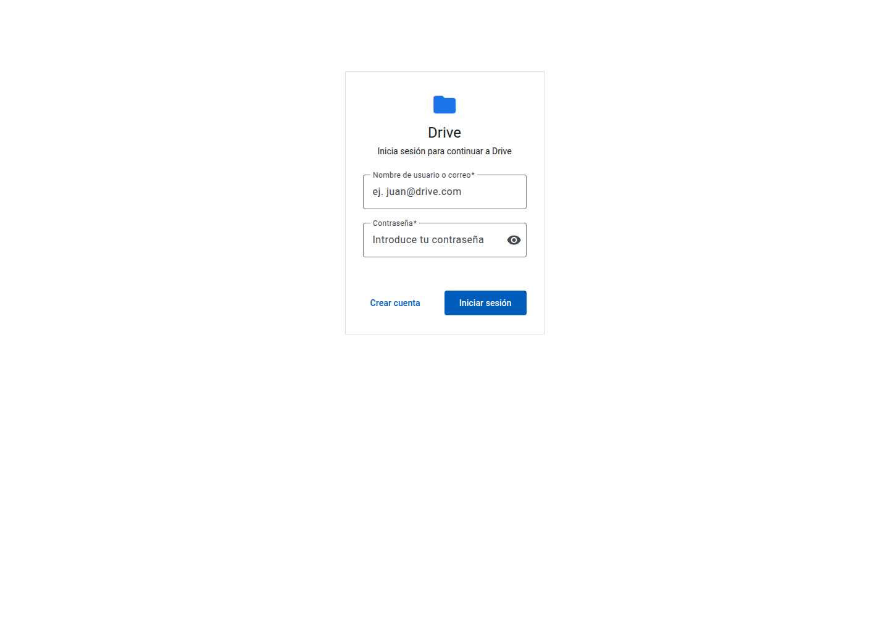

*Figura 1. Pantalla de acceso al sistema.*

También puedes crear una cuenta desde **Crear cuenta**. El registro público crea
siempre una cuenta con rol **Usuario**; los permisos de administrador solo pueden
asignarse desde el panel de administración.

Si el correo o la contraseña no son correctos, verás un mensaje de error. Si tu cuenta
está desactivada, el sistema no permitirá el acceso hasta que un administrador la
reactive.

# 4. Conocer la interfaz

Después de iniciar sesión verás una barra lateral y una barra superior.

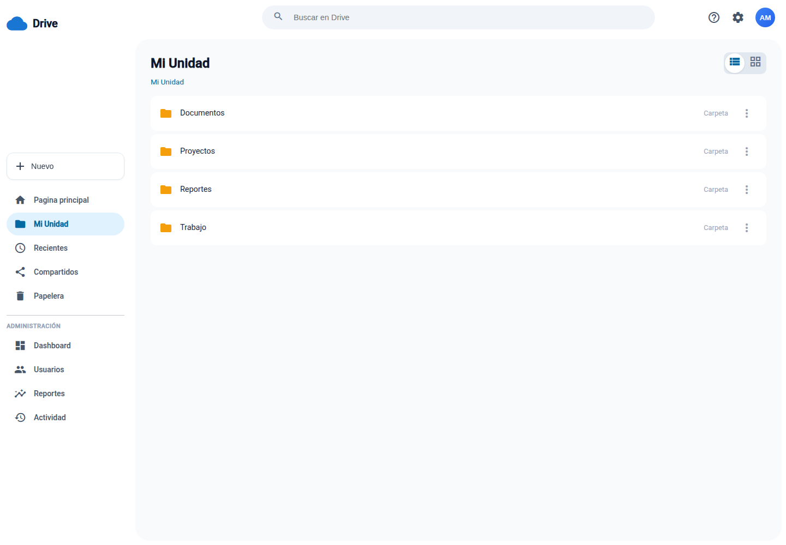

*Figura 2. Interfaz principal con la barra lateral y la barra de búsqueda.*

## 4.1 Barra lateral

| Elemento | Función |
|---|---|
| **Drive** | Colapsa o expande la barra lateral |
| **Nuevo** | Crea una carpeta, un archivo de texto o un archivo Markdown |
| **Página principal** | Vista inicial de la aplicación |
| **Mi Unidad** | Carpetas y archivos propios, además de carpetas compartidas |
| **Recientes** | Reservado para una versión futura |
| **Compartidos** | Reservado para una versión futura |
| **Papelera** | Elementos eliminados que pueden restaurarse |
| **Administración** | Visible solo para administradores |

## 4.2 Barra superior

- **Buscar en Drive**: busca archivos y carpetas por nombre.
- **Avatar**: abre el menú con **Mi perfil** y **Cerrar sesión**.

## 4.3 Menú contextual de cada recurso

Cada carpeta o archivo tiene un botón de tres puntos **⋮**. También puedes hacer clic
con el botón derecho sobre la fila para abrir el mismo menú.

Las opciones disponibles dependen de tus permisos:

- **Ver detalles**: disponible para cualquiera con acceso.
- **Renombrar**: disponible para el propietario y para usuarios con permiso de
  edición.
- **Compartir**: solo para el propietario.
- **Enviar a la papelera**: solo para el propietario.

# 5. Mi Unidad

**Mi Unidad** muestra el contenido de tu carpeta raíz. Desde allí puedes entrar en las
subcarpetas y abrir los archivos.

## 5.1 Navegar por carpetas

1. Pulsa una carpeta para entrar.
2. Usa la flecha **←** de la cabecera para volver a la carpeta anterior.
3. La ruta bajo el título indica dónde estás, por ejemplo `Mi Unidad / Documentos`.

También verás carpetas que otros usuarios hayan compartido contigo. Su contenido se
abre igual que una carpeta propia, pero las acciones disponibles dependen del permiso
recibido.

## 5.2 Cambiar entre lista y cuadrícula

En la esquina superior derecha hay dos botones:

- **Vista de lista**: muestra una fila por recurso, con nombre, tipo y tamaño.
- **Vista de cuadrícula**: muestra tarjetas.

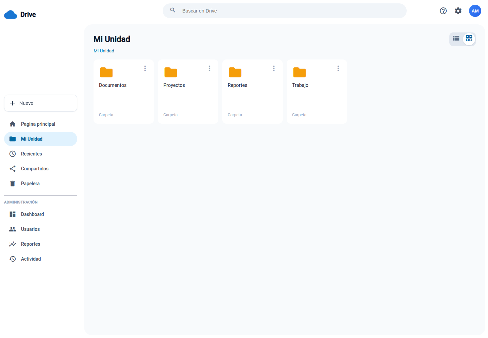

*Figura 3. Vista de cuadrícula de Mi Unidad.*

La preferencia se guarda en el navegador y se mantiene en tus próximas visitas.

## 5.3 Contenido de una carpeta

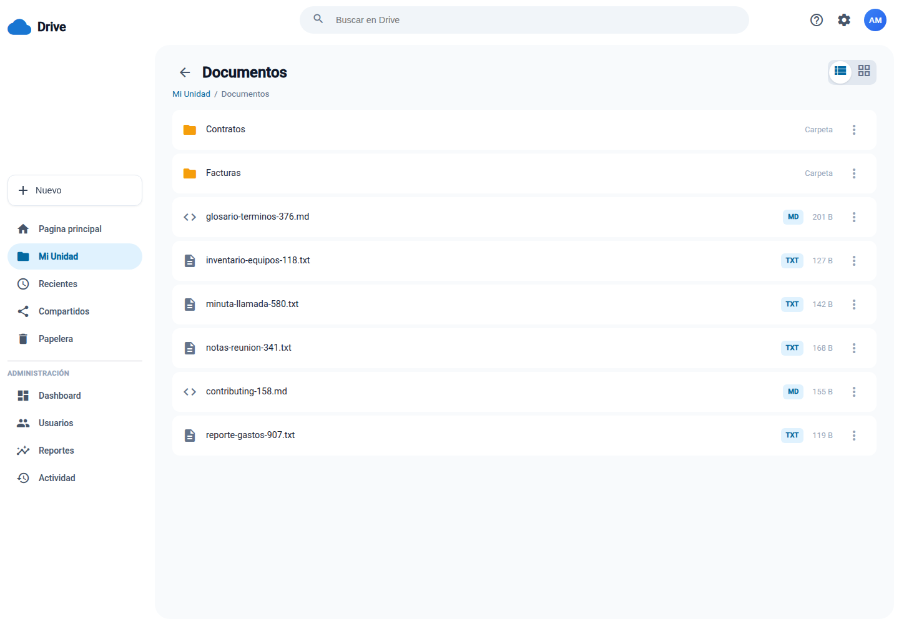

*Figura 4. Archivos y subcarpetas dentro de una carpeta.*

Las carpetas aparecen primero y los archivos después. Cada archivo muestra:

- un icono según el tipo (`TXT` o `MD`);
- su nombre;
- su tamaño en bytes, KB o MB.

# 6. Crear carpetas y archivos

## 6.1 Crear una carpeta

1. Entra en la carpeta donde quieres crearla o quédate en **Mi Unidad** para crearla
   en la raíz.
2. Pulsa **Nuevo** en la barra lateral.
3. Elige **Nueva carpeta**.
4. Escribe el nombre. El texto predeterminado es “Nueva carpeta”.
5. Pulsa **Crear**.

La carpeta aparece en la ubicación actual. No se permite repetir el nombre de otra
carpeta activa en la misma ubicación.

## 6.2 Crear un archivo de texto o Markdown

1. Entra en la carpeta de destino.
2. Pulsa **Nuevo**.
3. Elige **Nuevo archivo de texto** (`.txt`) o **Nuevo archivo de markdown** (`.md`).
4. Escribe el nombre **sin la extensión**. El sistema la añade automáticamente.
5. Pulsa **Crear**.

Al crear un archivo, se abre directamente el editor para que puedas escribir el
contenido. El nombre final incluye la extensión; por ejemplo, si escribes `informe` y
eligas Markdown, se guardará como `informe.md`.

> **Consejo:** no escribas `.md` o `.txt` en el campo de nombre, porque se añadiría
> otra vez y quedaría algo como `informe.md.md`.

# 7. Abrir y leer un archivo

Pulsa un archivo de la lista para abrirlo en el visor.

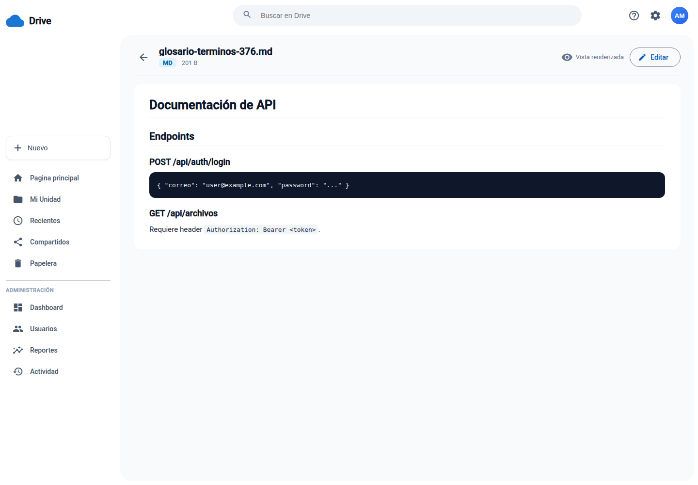

*Figura 5. Visor con un archivo Markdown renderizado.*

El visor se adapta al tipo de archivo:

- **Markdown (`.md`)**: muestra el contenido renderizado, con títulos, listas, enlaces
  y bloques de código.
- **Texto plano (`.txt`)**: muestra el contenido tal cual, conservando espacios y
  saltos de línea.

En la cabecera verás el nombre, el tipo, el tamaño y el modo de visualización. Si
tienes permiso de edición, aparece el botón **Editar**.

# 8. Editar un archivo

1. Abre el archivo.
2. Pulsa **Editar** o entra desde la URL de edición.
3. Modifica el contenido en el área de texto.
4. Pulsa **Guardar**.

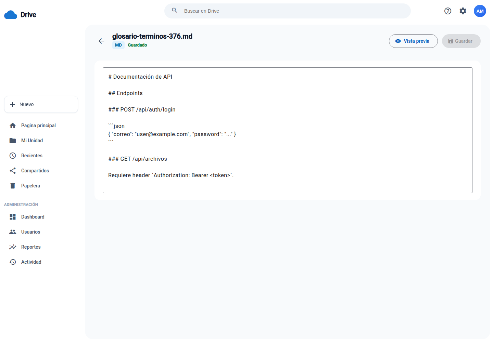

*Figura 6. Editor con el estado “Guardado”.*

Durante la edición:

- La cabecera indica **Guardado** o **Cambios sin guardar**.
- En archivos Markdown puedes alternar entre **Editar** y **Vista previa**.
- Puedes guardar con el botón **Guardar** o con **Ctrl+S** (Windows/Linux) o
  **Cmd+S** (macOS).
- Si intentas salir con cambios pendientes, el sistema pide confirmación.

El editor solo está disponible si tienes permiso de **edición** sobre el archivo. Si
solo tienes permiso de lectura o de comentarios, el botón **Editar** no aparece.

# 9. Compartir y permisos

Solo el propietario de un archivo o carpeta puede compartirlo.

## 9.1 Compartir un recurso

1. Abre el menú **⋮** del recurso.
2. Elige **Compartir**.
3. Busca a la persona por nombre o correo.
4. Selecciona el usuario.
5. Elige el permiso.
6. Pulsa **Compartir**.

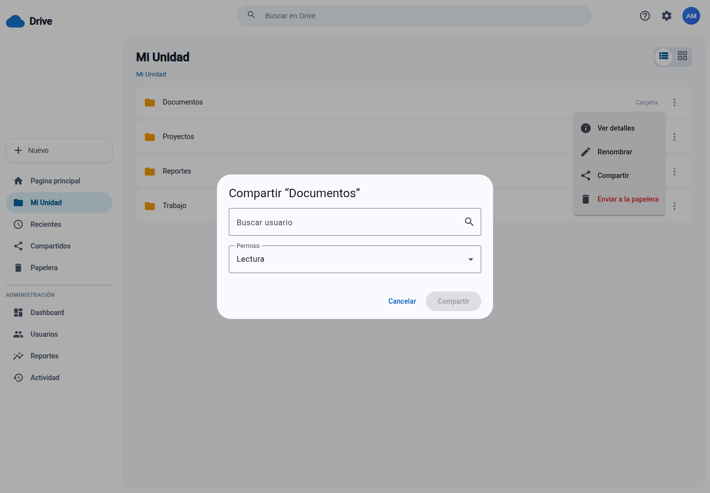

*Figura 7. Diálogo para compartir una carpeta.*

Si el recurso ya estaba compartido con esa persona, el diálogo muestra su permiso
actual y, al confirmar, lo actualiza.

## 9.2 Niveles de permiso

| Permiso | Qué permite |
|---|---|
| **Lectura** | Ver el contenido y descargarlo |
| **Edición** | Ver, descargar y modificar el contenido o el nombre |
| **Comentarios** | Acceso de lectura; el módulo de comentarios aún no está incluido |

Aclaraciones importantes:

- Compartir y enviar a la papelera siguen siendo exclusivos del propietario, incluso
  si otra persona tiene permiso de edición.
- El permiso sobre una carpeta se hereda a su contenido, salvo que un archivo o
  subcarpeta tenga un permiso directo diferente.
- No puedes compartir contigo mismo.
- Solo puedes compartir con usuarios activos.

## 9.3 Consultar quién tiene acceso

En **Ver detalles** se muestra la lista de personas con acceso, su permiso y, cuando
corresponde, el origen del permiso (por ejemplo, herencia desde una carpeta).

# 10. Renombrar y ver detalles

## 10.1 Renombrar

1. Abre el menú **⋮**.
2. Elige **Renombrar**.
3. Escribe el nuevo nombre.
4. Confirma.

Si renombras un archivo, conserva la extensión `.txt` o `.md` para que el visor y el
editor lo sigan tratando correctamente. No se permite un nombre duplicado en la misma
ubicación.

## 10.2 Ver detalles

La opción **Ver detalles** muestra:

- tipo de recurso;
- tamaño (en archivos);
- ubicación;
- cantidad de archivos y subcarpetas (en carpetas);
- fecha de creación y de última modificación;
- personas con acceso y su nivel de permiso.

# 11. Buscar en el sistema

1. Escribe al menos un carácter en **Buscar en Drive**.
2. Espera las sugerencias.
3. Pulsa un resultado para abrir la carpeta o el archivo.

La búsqueda:

- es parcial y no distingue mayúsculas;
- busca en recursos propios, compartidos directamente y dentro de carpetas
  compartidas;
- agrupa los resultados en **Carpetas** y **Archivos**;
- muestra un aviso cuando no hay coincidencias.

# 12. Papelera

Cuando envías un recurso a la papelera, no se borra de inmediato. Puedes recuperarlo
después.

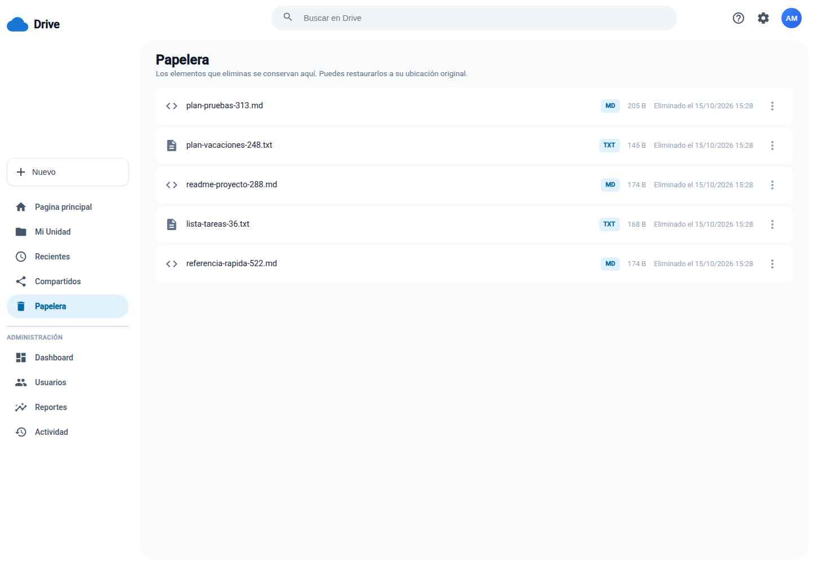

*Figura 8. Papelera con carpetas y archivos eliminados.*

## 12.1 Enviar a la papelera

1. Abre el menú **⋮** del recurso.
2. Elige **Enviar a la papelera**.
3. Confirma la acción.

Si envías una carpeta, también se envían a la papelera todos sus archivos y
subcarpetas. En la lista de la papelera solo aparece la carpeta que eliminaste, no
cada elemento interno.

## 12.2 Restaurar

1. Entra en **Papelera**.
2. Abre el menú **⋮** del recurso.
3. Elige **Restaurar**.

La restauración devuelve el recurso a su ubicación original. Si eliminaste una carpeta
completa, debes restaurar la carpeta; los elementos internos se recuperan con ella.

## 12.3 Limitaciones

- Solo puedes ver y restaurar recursos propios.
- No se puede restaurar un recurso si su carpeta contenedora sigue en la papelera.
- En esta versión no hay una opción de borrado permanente desde la interfaz. Los
  elementos permanecen en la papelera hasta que se implemente ese flujo.

# 13. Mi perfil

Pulsa tu avatar y elige **Mi perfil**.

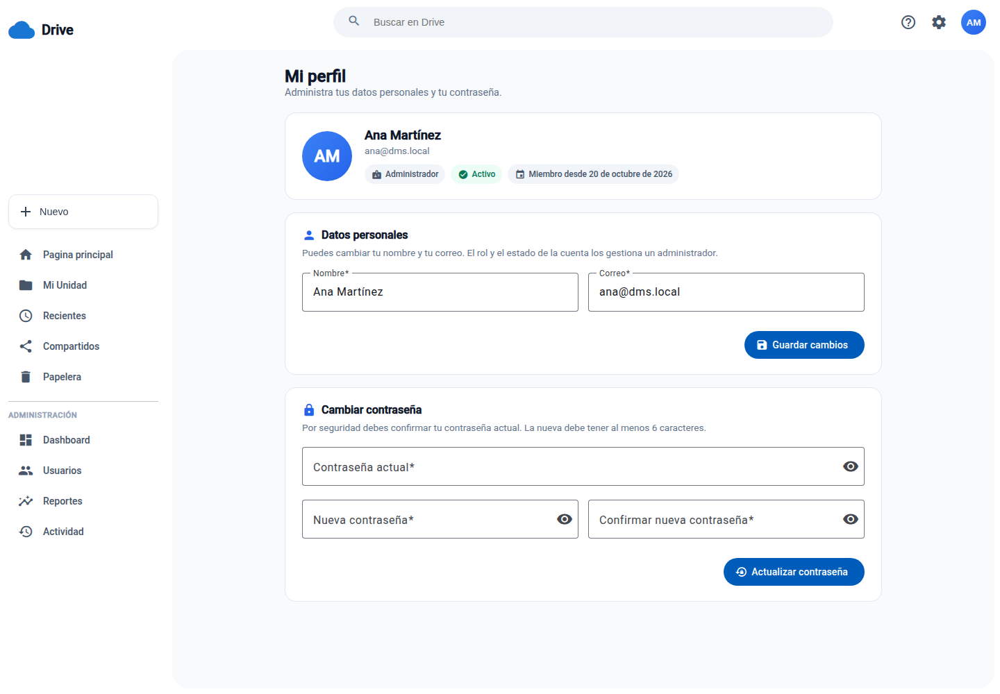

*Figura 9. Datos personales y cambio de contraseña.*

## 13.1 Datos personales

Puedes cambiar:

- tu **nombre**;
- tu **correo**.

El rol y el estado de la cuenta los gestiona un administrador. Si el correo ya está
en uso por otra cuenta, el sistema mostrará un error.

## 13.2 Cambiar contraseña

1. Escribe tu contraseña actual.
2. Escribe la nueva contraseña (mínimo 6 caracteres).
3. Repite la nueva contraseña.
4. Pulsa **Actualizar contraseña**.

La nueva contraseña debe ser diferente a la actual. Si no recuerdas tu contraseña, no
hay un flujo de recuperación automática en esta versión: contacta con el
administrador.

# 14. Panel de administración

El bloque **Administración** solo aparece para usuarios con rol administrador. Incluye
cuatro secciones.

## 14.1 Dashboard

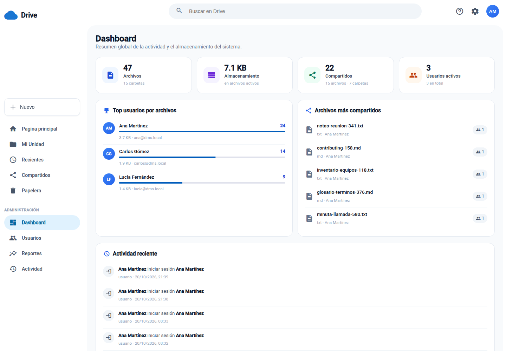

*Figura 10. Resumen global del sistema.*

Muestra:

- total de archivos y carpetas;
- almacenamiento ocupado por archivos activos;
- cantidad de recursos compartidos;
- usuarios activos y totales;
- top de usuarios por cantidad de archivos;
- archivos más compartidos;
- actividad reciente.

## 14.2 Usuarios

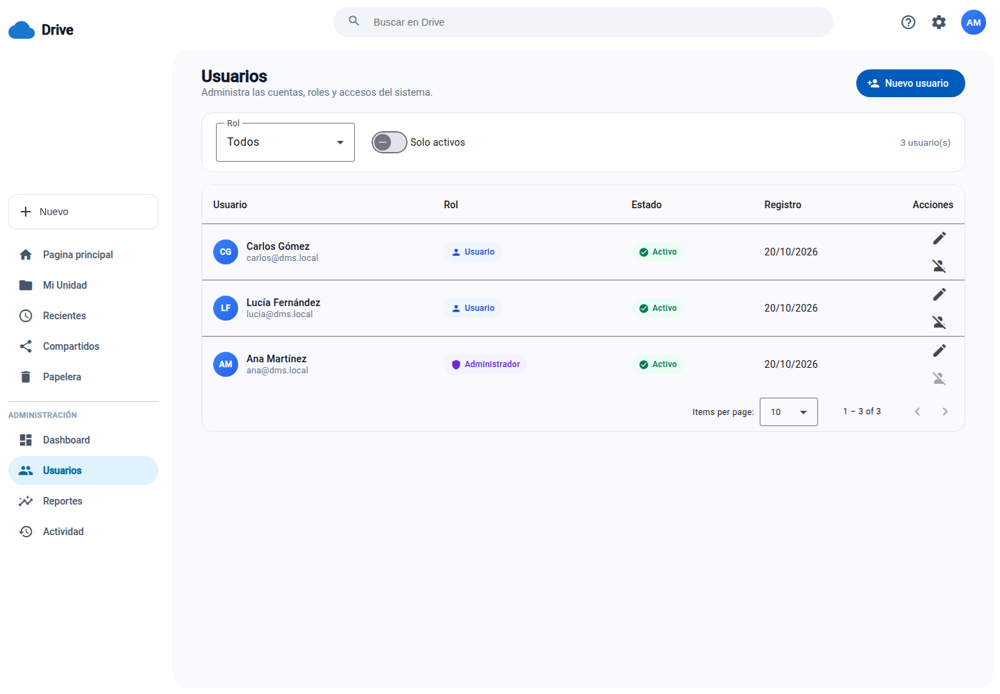

*Figura 11. Listado y administración de usuarios.*

Desde aquí el administrador puede:

- filtrar por rol y por estado;
- crear un usuario con nombre, correo, contraseña inicial y rol;
- editar nombre, correo y rol;
- desactivar una cuenta;
- reactivar una cuenta desactivada;
- consultar la fecha de registro.

Reglas de seguridad:

- un administrador no puede desactivar su propia cuenta;
- un administrador no puede cambiarse su propio rol;
- una cuenta desactivada no puede iniciar sesión;
- los cambios de rol se aplican sin esperar a que caduque la sesión.

## 14.3 Reportes

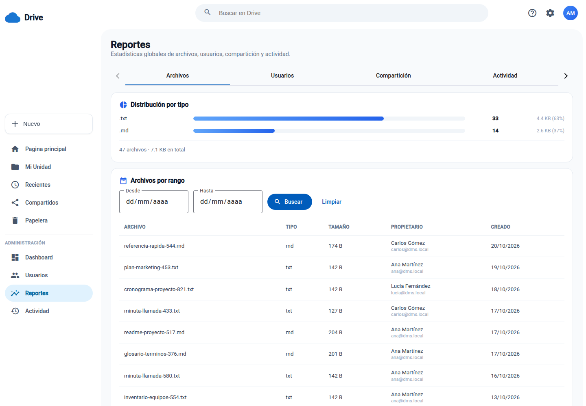

*Figura 12. Reportes de archivos y almacenamiento.*

Los reportes se organizan en cuatro pestañas:

| Pestaña | Contenido |
|---|---|
| **Archivos** | Distribución por tipo, archivos por rango de fechas y archivos con más operaciones |
| **Usuarios** | Top de usuarios por archivos y usuarios con más recursos compartidos |
| **Compartición** | Archivos más compartidos y detalle por usuario |
| **Actividad** | Operaciones globales por tipo y por período (día, mes o año) |

En **Archivos por rango** puedes elegir una fecha **Desde** y otra **Hasta**, pulsar
**Buscar** y limpiar el filtro con **Limpiar**. En **Detalle por usuario** se muestran
los recursos que esa persona compartió y los que recibió.

## 14.4 Actividad del sistema

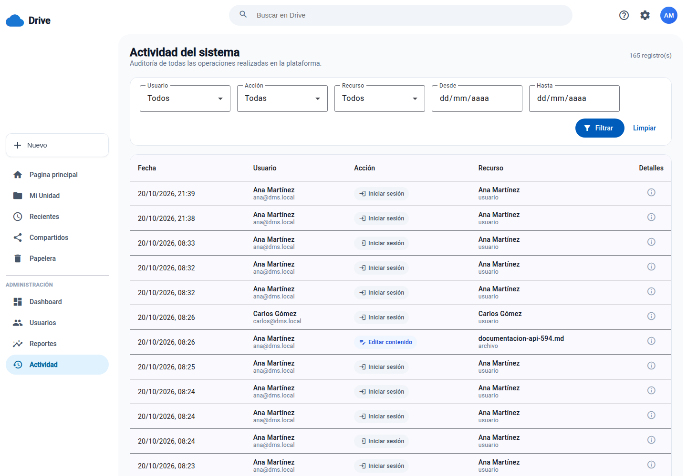

*Figura 13. Historial global de actividad.*

La auditoría permite filtrar por:

- usuario;
- acción;
- tipo de recurso;
- fecha desde y hasta.

La tabla muestra fecha, usuario, acción, recurso y un icono de información con los
detalles de la operación. Los resultados se pueden paginar.

Las acciones registradas incluyen creación, renombrado, movimiento, edición de
contenido, compartición, retiro de permisos, envío a papelera, restauración, inicio de
sesión, registro, desactivación y reactivación.

# 15. Preguntas frecuentes

## No puedo iniciar sesión

Comprueba el correo y la contraseña. Si son correctos, tu cuenta puede estar
desactivada; en ese caso un administrador debe reactivarla. También verifica que el
servidor esté disponible.

## La aplicación muestra un error de conexión

En un entorno local, comprueba que el backend esté ejecutándose en el puerto `3000` y
que el frontend use `http://localhost:4200`. El origen debe coincidir con la
configuración CORS del servidor; `127.0.0.1` y `localhost` no son equivalentes para
CORS.

## No veo el botón Editar

Solo aparece con permiso de **edición** o si eres el propietario. Con permiso de
**lectura** o **comentarios** el archivo es de solo lectura.

## No puedo compartir ni eliminar

Esas acciones son exclusivas del propietario. Un permiso de edición permite modificar
el contenido y el nombre, pero no compartir ni enviar a la papelera.

## Ya existe una carpeta o archivo con ese nombre

Dentro de una misma ubicación no puede haber dos recursos activos con el mismo nombre.
Cambia el nombre o mueve el recurso a otra carpeta.

## El archivo es demasiado grande

El contenido máximo es de 10 millones de caracteres y la petición HTTP tiene un límite
de 16 MB. Divide el documento o reduce su tamaño.

## ¿Puedo usar comentarios?

El nivel **Comentarios** existe al compartir, pero en esta versión solo concede acceso
de lectura. Todavía no hay un panel para publicar comentarios.

## ¿Cómo borro definitivamente un elemento?

En esta versión no hay borrado permanente desde la interfaz. Puedes restaurar el
elemento o dejarlo en la papelera.

## ¿Dónde están Recientes y Compartidos?

Son entradas reservadas para una versión futura. Por ahora puedes encontrar recursos
compartidos desde **Mi Unidad**, la búsqueda o los reportes del administrador.

## ¿Puedo mover archivos o carpetas?

La API permite mover recursos, pero la interfaz actual no expone esa acción en el menú
contextual. Está prevista para una versión posterior.

# 16. Glosario

| Término | Significado |
|---|---|
| **Archivo** | Documento `.txt` o `.md` almacenado en el sistema |
| **Carpeta** | Contenedor que puede incluir archivos y otras carpetas |
| **Mi Unidad** | Espacio personal desde el que se exploran los recursos |
| **Propietario** | Usuario dueño de un archivo o carpeta |
| **Permiso** | Nivel de acceso concedido a otro usuario |
| **Herencia** | Permiso de una carpeta que se aplica a su contenido |
| **Papelera** | Espacio temporal para recursos eliminados |
| **Markdown** | Formato de texto con marcas para títulos, listas y código |
| **JWT** | Mecanismo de sesión usado por la aplicación |

---

**Sistema de Gestión Documental (DMS)** · Proyecto académico · CUNOC · 2026
