# Diagrama de casos de uso

Casos de uso del sistema actual, agrupados por módulo funcional. El módulo de
comentarios no se incluye porque todavía no está implementado.

```mermaid
flowchart LR
    Visitante["Visitante"]
    Usuario["Usuario"]
    Admin["Administrador"]

    subgraph SISTEMA["Sistema de Gestión Documental"]
        direction TB

        subgraph AUT["Autenticación"]
            UC_Registro(["Registrarse"])
            UC_Login(["Iniciar sesión"])
            UC_Logout(["Cerrar sesión"])
        end

        subgraph DOC["Documentos"]
            UC_VerMiUnidad(["Ver Mi Unidad"])
            UC_CrearCarpeta(["Crear carpeta"])
            UC_CrearArchivo(["Crear archivo"])
            UC_VerArchivo(["Ver archivo"])
            UC_DescargarArchivo(["Descargar archivo"])
            UC_EditarArchivo(["Editar archivo"])
            UC_RenombrarRecurso(["Renombrar recurso"])
            UC_MoverRecurso(["Mover recurso"])
        end

        subgraph COMP["Compartición"]
            UC_CompartirRecurso(["Compartir recurso"])
            UC_QuitarCompartido(["Quitar compartición"])
        end

        subgraph BUS["Búsqueda"]
            UC_Buscar(["Buscar recursos"])
        end

        subgraph ACTIVIDAD["Actividad"]
            UC_VerRecientes(["Ver recientes"])
            UC_VerCompartidos(["Ver compartidos conmigo"])
            UC_VerHistorial(["Ver historial de recurso"])
        end

        subgraph PAPELERA["Papelera"]
            UC_EnviarPapelera(["Enviar a papelera"])
            UC_Restaurar(["Restaurar recurso"])
        end

        subgraph PERFIL["Perfil"]
            UC_VerPerfil(["Ver perfil"])
            UC_EditarPerfil(["Editar perfil"])
            UC_CambiarPassword(["Cambiar contraseña"])
        end

        subgraph ADMIN["Administración"]
            UC_GestionarUsuarios(["Gestionar usuarios"])
            UC_CrearUsuario(["Crear usuario"])
            UC_CambiarRol(["Cambiar rol"])
            UC_DesactivarReactivar(["Desactivar o reactivar usuario"])
            UC_VerDashboard(["Ver dashboard"])
            UC_VerReportes(["Ver reportes"])
            UC_VerActividadGlobal(["Ver actividad global"])
        end
    end

    Visitante --> UC_Registro
    Visitante --> UC_Login

    Usuario --> UC_Login
    Usuario --> UC_Logout
    Usuario --> UC_VerMiUnidad
    Usuario --> UC_CrearCarpeta
    Usuario --> UC_CrearArchivo
    Usuario --> UC_VerArchivo
    Usuario --> UC_DescargarArchivo
    Usuario --> UC_EditarArchivo
    Usuario --> UC_RenombrarRecurso
    Usuario --> UC_MoverRecurso
    Usuario --> UC_CompartirRecurso
    Usuario --> UC_QuitarCompartido
    Usuario --> UC_Buscar
    Usuario --> UC_VerRecientes
    Usuario --> UC_VerCompartidos
    Usuario --> UC_VerHistorial
    Usuario --> UC_EnviarPapelera
    Usuario --> UC_Restaurar
    Usuario --> UC_VerPerfil
    Usuario --> UC_EditarPerfil
    Usuario --> UC_CambiarPassword

    Admin -.->|hereda| Usuario
    Admin --> UC_GestionarUsuarios
    Admin --> UC_VerDashboard
    Admin --> UC_VerReportes
    Admin --> UC_VerActividadGlobal

    UC_GestionarUsuarios -.->|incluye| UC_CrearUsuario
    UC_GestionarUsuarios -.->|incluye| UC_CambiarRol
    UC_GestionarUsuarios -.->|incluye| UC_DesactivarReactivar
```

## Notas

- Todos los casos del `Usuario` requieren una sesión activa con JWT válido.
- El `Administrador` hereda los casos del `Usuario` y conserva el menú normal.
- La papelera usa eliminación lógica; el borrado permanente no se expone como caso
  de uso independiente.
- El registro público es el único caso disponible sin sesión, además del inicio de
  sesión.
