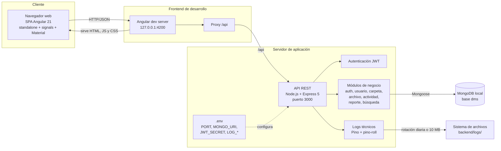

# Diagrama de despliegue

Despliegue del entorno validado: SPA Angular servida por el servidor de desarrollo,
API REST Node.js/Express y MongoDB local. No existen Docker, CI/CD ni despliegue
productivo configurado.

## Notas

- El frontend consume la API mediante el proxy de Angular en desarrollo.
- La API valida el token JWT en cada solicitud protegida y refresca el usuario y su
  rol desde MongoDB.
- Los logs se escriben en `backend/logs/` con rotación y sin datos sensibles.
- MongoDB es una instancia local; no hay réplica ni clúster.
- El despliegue productivo queda fuera del alcance actual.
