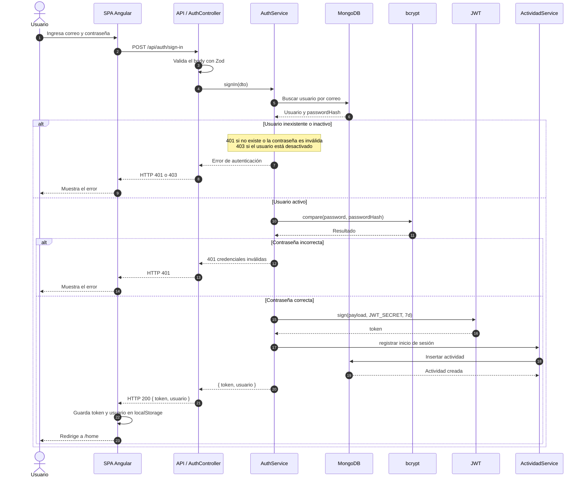

# Secuencia: inicio de sesión

Flujo de autenticación con correo y contraseña, emisión del JWT y registro de la
actividad de inicio de sesión.

## Notas

- El token se envía después en la cabecera `Authorization: Bearer <token>`.
- El middleware de autenticación vuelve a consultar el usuario y su rol en MongoDB.
- Un usuario inactivo o un token inválido produce `401`; las credenciales
  incorrectas también producen `401`.
