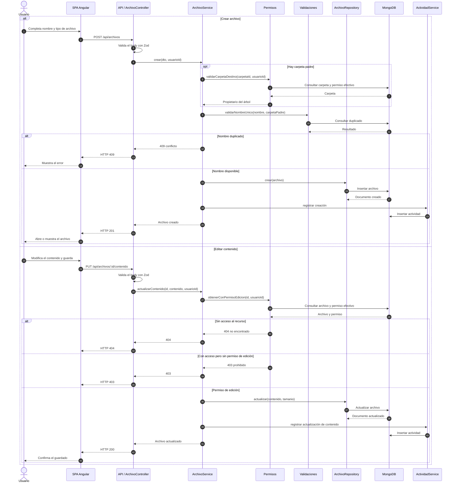

# Secuencia: crear y editar archivo

Creación de archivos en Mi Unidad o dentro de una carpeta, y edición de contenido
con validación de permisos.

## Notas

- El tamaño se recalcula con `Buffer.byteLength` a partir del contenido.
- El nombre se valida contra la carpeta padre y el propietario del árbol.
- Sin acceso al recurso se responde `404`; con acceso pero sin permiso de edición se
  responde `403`.
- La edición requiere permiso de escritura, ser propietario directo o ser propietario
  del árbol de carpetas.
