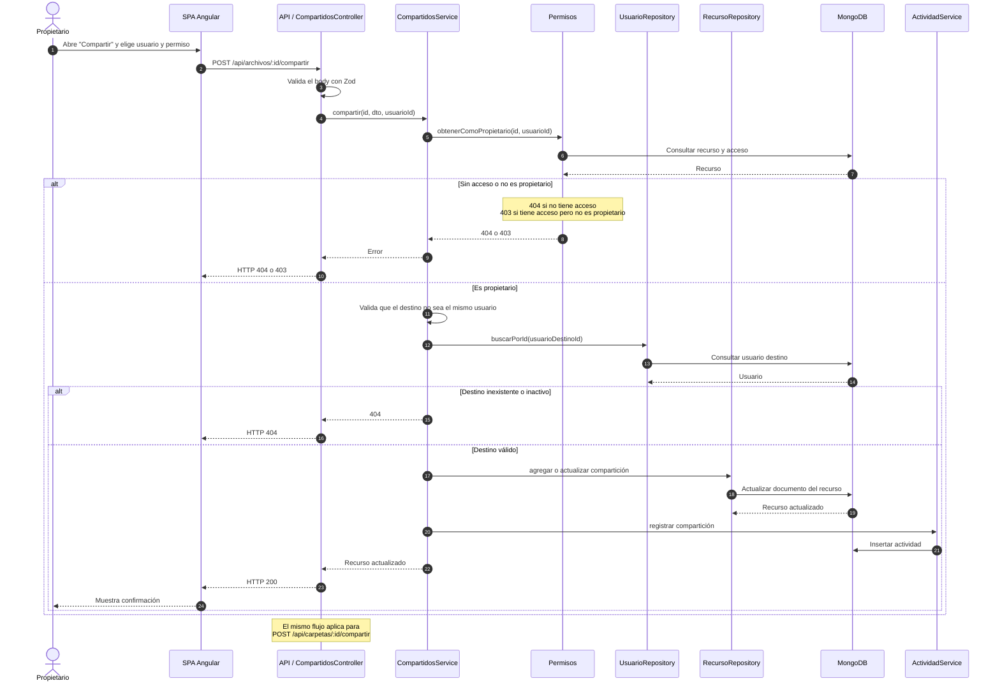

# Secuencia: compartir recurso

El propietario comparte un archivo o carpeta con otro usuario y define el nivel de
permiso: lectura, escritura o comentar.

## Notas

- Un usuario no puede compartir un recurso consigo mismo.
- Solo el propietario directo puede modificar la compartición.
- Compartir o actualizar un permiso queda registrado en la actividad.
- El permiso `comentar` existe en el modelo, pero hoy se comporta como lectura
  porque el módulo de comentarios no está implementado.
