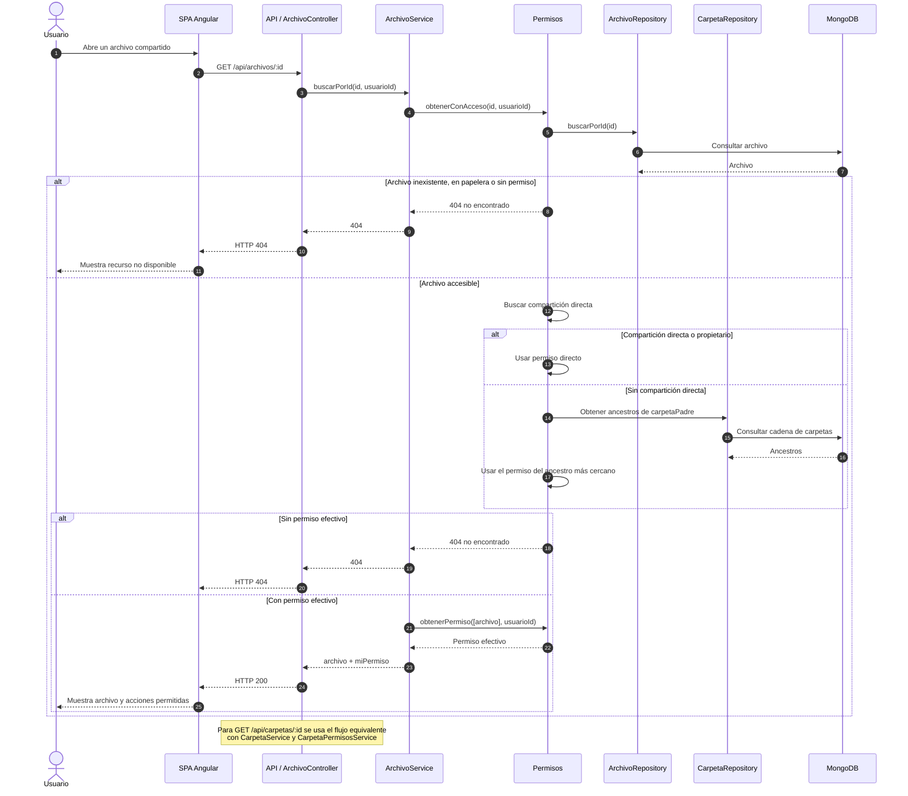

# Secuencia: acceso a recurso compartido

Resolución del permiso efectivo cuando un usuario abre un archivo o carpeta que
recibió directamente o que está dentro de una carpeta compartida.

## Notas

- La compartición directa tiene prioridad sobre la herencia de carpeta.
- Si no hay compartición directa, se busca el ancestro más cercano con permiso.
- La ausencia de acceso se oculta con `404`; no se revela la existencia del recurso.
- El permiso efectivo se devuelve como `miPermiso` para que el frontend habilite o
  deshabilite acciones.
