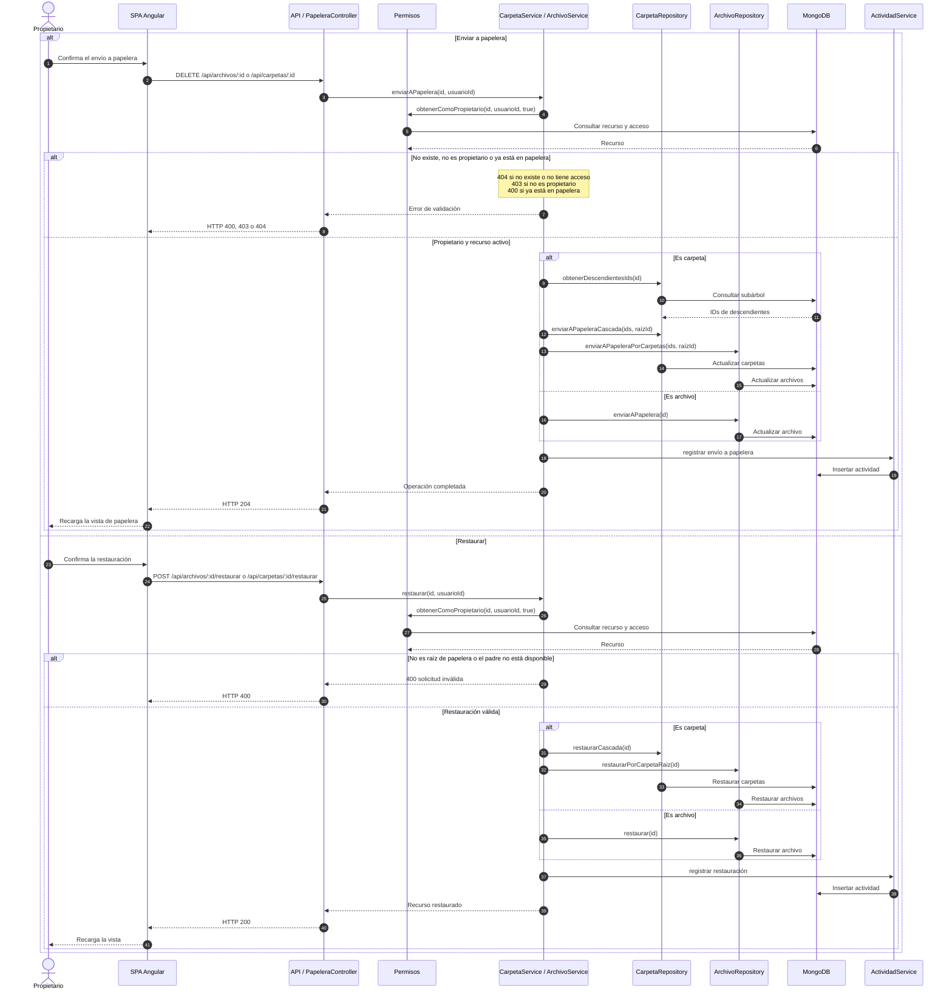

# Secuencia: papelera

Envío de archivos o carpetas a la papelera con eliminación lógica en cascada, y
restauración posterior.

## Notas

- Solo el propietario puede enviar a papelera o restaurar.
- En carpetas, la operación se aplica en cascada a todo el subárbol.
- Un elemento solo se restaura si es la raíz enviada a papelera y su carpeta padre
  sigue disponible.
- La eliminación es lógica; no se borra el documento de MongoDB.
