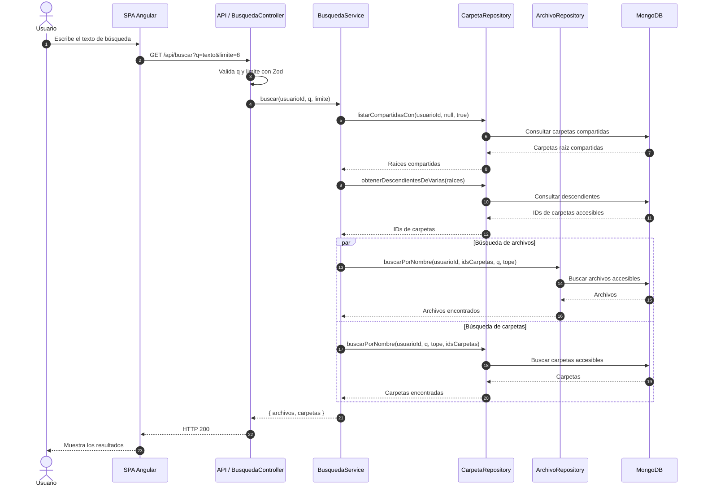

# Secuencia: búsqueda de recursos

Búsqueda de archivos y carpetas por nombre, incluyendo recursos propios, compartidos
directamente y descendientes de carpetas compartidas.

## Notas

- La búsqueda usa el nombre y no devuelve recursos sin acceso.
- Se incluyen recursos propios, compartidos directamente y descendientes de carpetas
  compartidas.
- El límite por defecto es 8 y el máximo permitido es 20.
- Los recursos en papelera no aparecen en los resultados.
