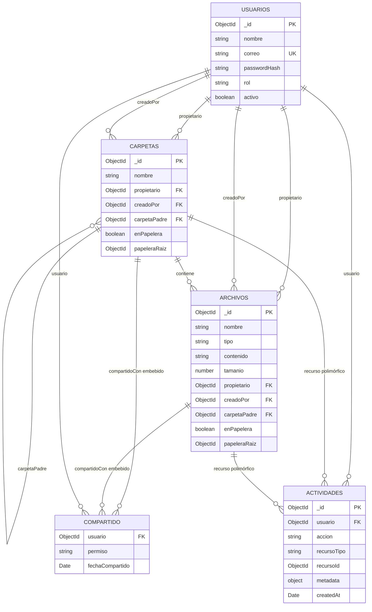

# Modelo documental

Modelo de datos del sistema sobre MongoDB (`dms`). Se resumen las colecciones,
documentos embebidos, referencias e índices principales. El módulo de comentarios no
está incluido porque todavía no está implementado.

## Colecciones

| Colección | Propósito |
|---|---|
| `usuarios` | Cuentas, credenciales, rol y estado. |
| `carpetas` | Árbol de carpetas, propiedad, compartición y papelera. |
| `archivos` | Archivos `.txt` y `.md`, contenido y compartición. |
| `actividades` | Auditoría de las operaciones del sistema. |

`COMPARTIDO` representa el subdocumento `compartidoCon`, no una colección
independiente.

## `usuarios`

| Campo | Tipo | Observaciones |
|---|---|---|
| `_id` | `ObjectId` | Identificador. |
| `nombre` | `string` | 2–150 caracteres. |
| `correo` | `string` | Único, minúsculas y `trim`. |
| `passwordHash` | `string` | bcrypt; `select: false` y oculto en `toJSON`. |
| `rol` | `string` | `usuario` o `administrador`. |
| `activo` | `boolean` | Controla el acceso. |
| `createdAt`, `updatedAt` | `Date` | Timestamps automáticos. |

## `carpetas`

| Campo | Tipo | Observaciones |
|---|---|---|
| `_id` | `ObjectId` | Identificador. |
| `nombre` | `string` | 1–200 caracteres. |
| `propietario` | `ObjectId → usuarios` | Dueño del árbol. |
| `creadoPor` | `ObjectId → usuarios` | Autor de la creación. |
| `carpetaPadre` | `ObjectId → carpetas` o `null` | `null` indica raíz. |
| `compartidoCon` | arreglo embebido | Permisos directos por usuario. |
| `enPapelera` | `boolean` | Eliminación lógica. |
| `fechaEnvioPapelera` | `Date` o `null` | Fecha del envío. |
| `papeleraRaiz` | `ObjectId` o `null` | Raíz del envío en cascada. |
| `createdAt`, `updatedAt` | `Date` | Timestamps automáticos. |

La jerarquía usa `carpetaPadre` como lista de adyacencia. Al mover una carpeta, todo
su subárbol y sus archivos cambian de propietario para conservar un único dueño por
árbol. El nombre es único entre carpetas activas del mismo propietario y padre.

## `archivos`

| Campo | Tipo | Observaciones |
|---|---|---|
| `_id` | `ObjectId` | Identificador. |
| `nombre` | `string` | 1–300 caracteres. |
| `tipo` | `string` | `txt` o `md`. |
| `contenido` | `string` | Contenido embebido, hasta 10 000 000 de caracteres. |
| `tamanio` | `number` | Bytes UTF-8 del contenido. |
| `propietario` | `ObjectId → usuarios` | Dueño del árbol. |
| `creadoPor` | `ObjectId → usuarios` | Autor de la creación. |
| `carpetaPadre` | `ObjectId → carpetas` o `null` | Ubicación; `null` indica raíz. |
| `compartidoCon` | arreglo embebido | Permisos directos por usuario. |
| `enPapelera` | `boolean` | Eliminación lógica. |
| `fechaEnvioPapelera` | `Date` o `null` | Fecha del envío. |
| `papeleraRaiz` | `ObjectId` o `null` | Archivo individual o carpeta que lo arrastró. |
| `createdAt`, `updatedAt` | `Date` | Timestamps automáticos. |

- `tamanio` se calcula con `Buffer.byteLength(contenido, 'utf8')`.
- En listados se excluye `contenido` salvo que se solicite.
- La unicidad de nombre se valida en el servicio; no hay índice único para archivos.

## `actividades`

| Campo | Tipo | Observaciones |
|---|---|---|
| `_id` | `ObjectId` | Identificador. |
| `usuario` | `ObjectId → usuarios` | Autor de la acción. |
| `usuarioNombre`, `usuarioCorreo` | `string` | Snapshots históricos. |
| `accion` | `string` | Enum de la operación. |
| `recursoTipo` | `string` | `archivo`, `carpeta`, `usuario` o `sistema`. |
| `recursoId` | `ObjectId` o `null` | Referencia polimórfica. |
| `recursoNombre` | `string` o `null` | Snapshot del nombre. |
| `metadata` | `object` | Datos variables por acción. |
| `createdAt` | `Date` | Fecha del registro. |

- Los snapshots conservan los nombres aunque el usuario o el recurso se renombren.
- `recursoTipo` indica cómo interpretar `recursoId`.
- `metadata` usa tipo `Mixed`; ejemplos: `{ tipo, tamanio }`, `{ usuarioDestino,
  permiso }`, `{ carpetaOrigen, carpetaDestino }` o `{ tamañoAnterior, tamañoNuevo }`.
- La auditoría es best-effort: si falla, no revierte la operación principal.

## Documentos embebidos

### `compartidoCon`

| Campo | Tipo | Observaciones |
|---|---|---|
| `usuario` | `ObjectId → usuarios` | Usuario destino. |
| `permiso` | `string` | `lectura`, `escritura` o `comentar`. |
| `fechaCompartido` | `Date` | Fecha de la compartición. |

Se guarda dentro de carpetas y archivos con `_id: false`. No existe una colección
intermedia de permisos. `comentar` existe en el modelo, pero hoy se comporta como
lectura porque el módulo de comentarios no está implementado.

### Otros datos embebidos

- `metadata`: datos específicos de cada actividad.
- `contenido`: texto completo del archivo.

## Referencias

| Campo | Origen | Destino |
|---|---|---|
| `propietario` | `carpetas`, `archivos` | `usuarios._id` |
| `creadoPor` | `carpetas`, `archivos` | `usuarios._id` |
| `carpetaPadre` | `carpetas`, `archivos` | `carpetas._id` o `null` |
| `compartidoCon.usuario` | `carpetas`, `archivos` | `usuarios._id` |
| `papeleraRaiz` | `carpetas` | `carpetas._id` |
| `papeleraRaiz` | `archivos` | `archivos._id` o `carpetas._id` |
| `usuario` | `actividades` | `usuarios._id` |
| `recursoId` | `actividades` | `archivos`, `carpetas`, `usuarios` o `null` |

No hay claves foráneas ni `JOIN`; la integridad se valida en los servicios. El campo
`recursoId` es polimórfico y se interpreta junto con `recursoTipo`.

## Índices

| Colección | Índices principales |
|---|---|
| `usuarios` | `correo` único; `rol`; `activo`. |
| `carpetas` | `propietario`; `carpetaPadre`; `enPapelera`; `creadoPor`; `papeleraRaiz`; `(propietario, carpetaPadre, enPapelera)`; `(carpetaPadre, enPapelera, nombre)`; `(compartidoCon.usuario, enPapelera)`; único parcial `(propietario, carpetaPadre, nombre)` con `enPapelera: false`. |
| `archivos` | `propietario`; `carpetaPadre`; `enPapelera`; `creadoPor`; `papeleraRaiz`; `tipo`; `(propietario, carpetaPadre, enPapelera)`; `(carpetaPadre, enPapelera)`; `(compartidoCon.usuario, enPapelera)`; texto sobre `nombre`. |
| `actividades` | `usuario`; `accion`; `recursoTipo`; `recursoId`; `(usuario, createdAt)`; `(accion, createdAt)`; `(recursoTipo, recursoId, createdAt)`; `createdAt`. |

- Cada colección tiene además el índice implícito `_id_`.
- Algunos índices simples son prefijos de índices compuestos; se documentan tal como
  existen.
- El índice de texto de archivos usa `nombre` e idioma `english` por defecto.
- La búsqueda global (`/api/buscar`) usa regex insensible a mayúsculas; el filtro de
  archivos por `busqueda` usa `$text`.

## Reglas e invariantes

- Cada árbol tiene un único propietario; `creadoPor` conserva al autor.
- Mover una carpeta transfiere la propiedad del subárbol y de sus archivos.
- La jerarquía se resuelve con `$graphLookup` y un límite de 20 niveles.
- La base no impone ciclos en `carpetaPadre`; el servicio los valida antes de mover.
- La papelera es lógica: `enPapelera`, `fechaEnvioPapelera` y `papeleraRaiz`.
- En una carpeta, la papelera y la restauración se aplican en cascada.
- Solo la raíz del envío puede restaurarse si su padre sigue disponible.
- La unicidad de nombres de carpetas activas está impuesta por MongoDB; la de
  archivos se valida en el servicio.
- No hay índices TTL: actividades y papelera se conservan hasta su eliminación.
- La colección se llama `actividades` porque el nombre está fijado explícitamente en
  el esquema; la pluralización automática de Mongoose generaba `actividads`.
